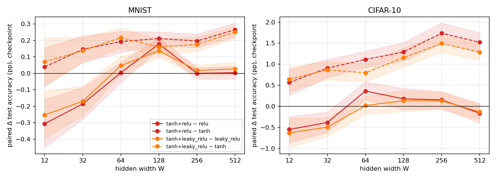
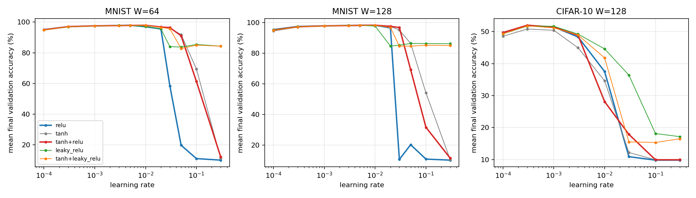
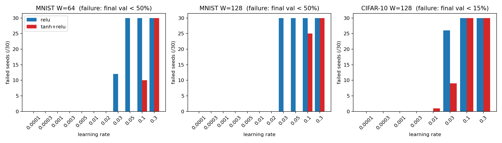
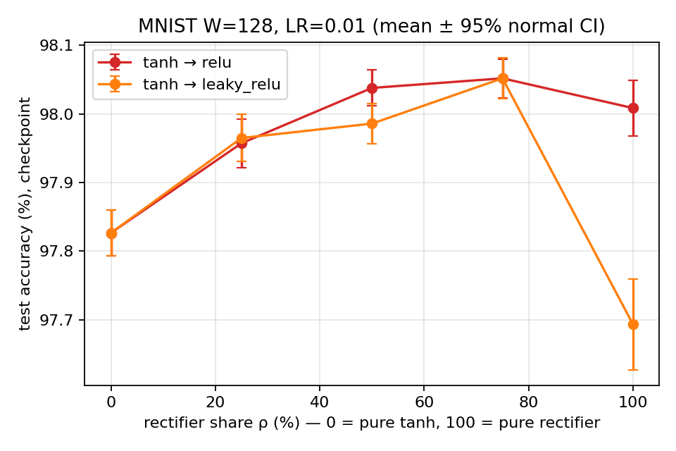

# Heterogeneous Activation Allocation in Multilayer Perceptrons: Accuracy, Learning-Rate Robustness, and the Effect of the Activation Allocation Ratio

**Report / manuscript draft — version 5 (AWS results)**
*Generated 15 September 2026 from the raw result CSVs in `results_aws/`. All numbers were recomputed from the CSVs; nothing in `manuscript_draft/` was read or modified.*

> **Draft conventions.** Unless stated otherwise, "accuracy" and "macro-F1" are **test scores at the validation-selected checkpoint** (`test_acc_best`, `test_f1_best`). Final-epoch scores are given in Appendix B. `±` is the standard deviation across 30 training seeds, not a confidence interval. Δ values are **paired by seed** (same seed → same data order and initial weights for the non-random layouts) and are reported in percentage points (pp) with 95% percentile bootstrap intervals (10,000 resamples of seed pairs). `*` marks a bootstrap interval that excludes zero. "Wins" counts seeds on which the hybrid scores higher. Text in *[brackets]* marks places where literature or author input is still needed.

---

## Abstract

Activation functions are almost always assigned homogeneously: every neuron in a hidden layer uses the same nonlinearity. We study a simple alternative in which each hidden layer is split between a bounded activation (tanh or sigmoid) and a rectifier (ReLU or leaky-ReLU), with neurons assigned by a fixed mask. Using a two-hidden-layer MLP on MNIST and CIFAR-10, six widths (12–512 neurons), 30 evaluation seeds per cell (2,520 main runs), per-configuration learning-rate calibration on disjoint seeds, dense 30-seed learning-rate sweeps (6,300 runs), an allocation-ratio/layout ablation and an MSE replication (13,620 runs in total), we find three consistent patterns. **(i) Accuracy:** the tanh+ReLU hybrid is the best configuration on average across widths on CIFAR-10 (mean rank 2.0 of 7) and second on MNIST (2.17, behind ReLU at 1.83); it is the top-ranked model in 5 of the 12 dataset–width cells, beats homogeneous tanh at 11 of 12 cells, and exceeds the mean of its two parents at 9 of 12 cells. Against the strongest homogeneous baseline, ReLU, its gains are small (up to +0.18 pp on MNIST and +0.36 pp on CIFAR-10) and appear only once the network is at least 64 neurons wide; at 12–32 neurons the hybrid is behind ReLU. **(ii) Robustness:** in learning-rate stress tests the hybrid is markedly harder to break. On MNIST it suffers **2.8–3.5× fewer near-chance training collapses than ReLU** and keeps accuracy within 2 pp of its peak at a **3× higher learning rate** (0.03 vs 0.01) at widths 32–128; at LR = 0.03 on MNIST-128 all 30 ReLU runs collapse to ≈10% while all 30 hybrid runs finish at 96.8%. On CIFAR-10 the same 2.9× reduction appears at LR = 0.03, but the advantage over the whole grid is smaller (1.2–1.3×). **(iii) Allocation ratio:** at a fixed learning rate, accuracy is a concave function of the rectifier share ρ, with the maximum at ρ = 50–75% rather than at either homogeneous extreme; for tanh+leaky-ReLU the ρ = 75% network beats both pure tanh (+0.23 pp) and pure leaky-ReLU (+0.36 pp) on 29/30 and 28/30 seeds. The hybrid advantage does not replicate under an MSE objective. Together, the results position heterogeneous activation allocation as a cheap, parameter-free way to obtain ReLU-level accuracy with substantially wider learning-rate tolerance in moderately wide MLPs.

---

## 1. Introduction

*[Literature context to be added: activation-function design (Glorot & Bengio 2010; Glorot, Bordes & Bengio 2011; He et al. 2015), learned/adaptive activations, mixtures of activations within a neuron, and prior heterogeneous-activation networks. Novelty claims must be checked against this literature; the phrase "activation ratio" has earlier, different uses and should not be claimed as new.]*

Homogeneous hidden layers force a single trade-off between the properties of an activation function. Rectifiers (ReLU, leaky-ReLU) give non-saturating gradients and sparse representations but are unbounded and, in plain ReLU, can permanently silence units whose preactivations become negative. Bounded, zero-centred functions such as tanh keep activations in [−1, 1] but saturate. A layer that contains both kinds of neurons can, in principle, combine the fast optimisation of rectifiers with the bounded, always-differentiable signal path of tanh.

This draft asks three questions:

1. **Accuracy.** Does assigning half of each hidden layer to tanh (or sigmoid) and half to a rectifier change test accuracy and macro-F1 relative to each homogeneous parent, and how does the answer depend on width and dataset?
2. **Robustness.** Does heterogeneity widen the range of learning rates over which training remains stable, i.e. reduce late-training collapse?
3. **Allocation ratio.** How do accuracy and stability change when the rectifier share ρ is 25%, 50% or 75% instead of 0% or 100%?

We define the **activation allocation ratio** ρ as the fraction of neurons in each hidden layer that are assigned to the second (rectifier) activation, ρ_l = N_act2,l / N_hidden,l. Each neuron carries exactly one activation; this is not a per-neuron blend ρ·ReLU(x) + (1−ρ)·tanh(x).

---

## 2. Experimental setup

### 2.1 Architecture and training protocol

| Item | Setting |
|---|---|
| Architecture | Fully connected MLP, D → H → H → 10 |
| Input dimension D | 784 (MNIST), 3072 (CIFAR-10); inputs scaled to [0, 1] |
| Hidden widths H | 12, 32, 64, 128, 256, 512 |
| Parameters | P(H, D) = H² + (D + 12)H + 10 (identical for all activation variants at a given width) |
| Output / loss (main) | Linear logits + softmax, cross-entropy |
| Output / loss (replication) | Sigmoid outputs, MSE (widths 64 and 128) |
| Optimiser | Plain SGD, batch size 1, per-epoch shuffling |
| Budget | 40 epochs; checkpoint with maximum validation accuracy is evaluated (all 40 epochs are computed) |
| Initialisation | U(−1/√fan_in, +1/√fan_in), zero biases (identical for every activation) |
| Derivative clipping | Element-wise clipping of dL/dz at ±10 |
| Leaky-ReLU slope | 0.1 |
| Data split | Fixed 45k / 5k / 10k train / validation / test. MNIST test = held-out slice of the 60k training file; CIFAR-10 test = official 10k test batch |
| Hybrid masks (main) | ρ = 0.5, `interleave` layout, same ρ in both hidden layers |
| Seeds | Calibration 101–106 (6 seeds); evaluation 1–30 (30 seeds) |

### 2.2 Configurations

| Label | Type | Hidden-layer composition | Parents |
|---|---|---|---|
| relu | homogeneous | 100% ReLU | — |
| leaky_relu | homogeneous | 100% leaky-ReLU | — |
| tanh | homogeneous | 100% tanh | — |
| sigmoid | homogeneous | 100% sigmoid | — |
| tanh+relu | hybrid | 50% tanh, 50% ReLU | tanh, relu |
| tanh+leaky_relu | hybrid | 50% tanh, 50% leaky-ReLU | tanh, leaky_relu |
| sigmoid+relu | hybrid | 50% sigmoid, 50% ReLU | sigmoid, relu |

### 2.3 Test suite

| Test | Files | Dataset(s) | Widths | Grid | Seeds | Runs | Purpose |
|---|---|---|---|---|---|---:|---|
| LR calibration | `calib_*.csv`, `c10_calib_*.csv` | MNIST, CIFAR-10 | all 6 | 7 configs × 8 LRs (1e-4 … 0.3) | 101–106 | 4,032 | Select LR per config/width; also used as a stress test |
| Main evaluation | `main_*.csv`, `c10_main_*.csv` | MNIST, CIFAR-10 | all 6 | 7 configs at calibrated LR | 1–30 | 2,520 | Accuracy, macro-F1, paired comparisons |
| Dense LR sweep | `lrsweep_64/128.csv` | MNIST | 64, 128 | 7 configs × 11 LRs | 1–30 | 4,620 | Seed-replicated robustness |
| Dense LR sweep | `c10_lrsweep_128.csv` | CIFAR-10 | 128 | 7 configs × 8 LRs | 1–30 | 1,680 | Robustness replication on a harder task |
| Ratio & layout | `layout_128.csv` | MNIST | 128 | 2 pairs × {ρ = 0.25, 0.5, 0.75 interleave; ρ = 0.5 block, random}, LR 0.01 | 1–30 | 300 | Allocation ratio and neuron placement |
| MSE calibration | `calib_mse_64/128.csv` | MNIST | 64, 128 | relu, tanh, tanh+relu × 8 LRs | 101–106 | 288 | LR selection under MSE |
| MSE evaluation | `mse_64/128.csv` | MNIST | 64, 128 | relu, tanh, tanh+relu | 1–30 | 180 | Loss-function replication |
| **Total** | 32 CSV files | | | | | **13,620** | all rows `status = ok` |

### 2.4 Metrics and statistical analysis

| Quantity | Definition |
|---|---|
| Checkpoint accuracy / macro-F1 | Test score of the epoch with the highest validation accuracy (primary endpoint) |
| Final-epoch accuracy | Test score after epoch 40 (Appendix B) |
| Paired Δ | mean over seeds of (hybrid − reference); positive favours the hybrid |
| 95% CI | percentile bootstrap over seed pairs, 10,000 resamples |
| p | two-sided paired t-test; Holm correction over the 72 hybrid-vs-parent checkpoint-accuracy tests (3 hybrids × 2 parents × 6 widths × 2 datasets) |
| Parent mean | per-seed average of the two parents' accuracies; hybrid − parent mean > 0 indicates a gain beyond simple interpolation |
| Near-chance collapse | final validation accuracy < 15% (10 classes → chance = 10%) |
| Other failure thresholds | final val < 50% (MNIST), < 25% (CIFAR-10), < 90% (MNIST, "useful accuracy lost") |
| Peak − final drop | best validation accuracy during training minus final validation accuracy |
| LR tolerance | largest LR, moving upward from a configuration's own best LR through contiguous grid points, at which the mean final validation accuracy stays within 2 pp of its peak (or at which no seed collapses) |
| Generalisation gap | clean training accuracy (fixed 10k training subset) at the selected epoch − checkpoint test accuracy |

---

## 3. Results I — Why the hybrid is better

### 3.1 Accuracy across widths

**Table 1a. MNIST, checkpoint test accuracy (%), mean ± SD over 30 seeds (bold = best in column).**

| config | W=12 | W=32 | W=64 | W=128 | W=256 | W=512 |
|---|---|---|---|---|---|---|
| relu | **94.30 ± 0.30** | **96.71 ± 0.19** | 97.58 ± 0.13 | 97.86 ± 0.07 | **98.21 ± 0.07** | 98.29 ± 0.06 |
| leaky_relu | 94.27 ± 0.23 | 96.68 ± 0.19 | 97.56 ± 0.11 | 97.85 ± 0.08 | 98.18 ± 0.06 | 98.25 ± 0.09 |
| tanh | 93.95 ± 0.26 | 96.37 ± 0.16 | 97.39 ± 0.12 | 97.83 ± 0.09 | 98.02 ± 0.07 | 98.02 ± 0.07 |
| sigmoid | 93.77 ± 0.33 | 96.27 ± 0.14 | 97.12 ± 0.08 | 97.66 ± 0.09 | 97.97 ± 0.07 | 98.04 ± 0.07 |
| tanh+relu | 93.99 ± 0.25 | 96.52 ± 0.18 | 97.58 ± 0.13 | **98.04 ± 0.07** | 98.21 ± 0.07 | **98.29 ± 0.09** |
| tanh+leaky_relu | 94.02 ± 0.32 | 96.51 ± 0.16 | **97.61 ± 0.12** | 97.99 ± 0.08 | 98.19 ± 0.07 | 98.27 ± 0.08 |
| sigmoid+relu | 93.77 ± 0.39 | 95.99 ± 0.17 | 96.71 ± 0.16 | 97.55 ± 0.14 | 98.04 ± 0.08 | 98.12 ± 0.07 |

**Table 1b. CIFAR-10, checkpoint test accuracy (%), mean ± SD over 30 seeds.**

| config | W=12 | W=32 | W=64 | W=128 | W=256 | W=512 |
|---|---|---|---|---|---|---|
| relu | 43.46 ± 0.74 | 49.19 ± 0.59 | 51.24 ± 0.50 | 53.04 ± 0.53 | 54.07 ± 0.51 | **54.88 ± 0.47** |
| leaky_relu | **43.62 ± 0.88** | **49.25 ± 0.49** | 51.27 ± 0.49 | 52.95 ± 0.51 | 53.85 ± 0.48 | 54.61 ± 0.42 |
| tanh | 42.34 ± 0.56 | 47.89 ± 0.48 | 50.49 ± 0.39 | 51.93 ± 0.52 | 52.49 ± 0.50 | 53.19 ± 0.49 |
| sigmoid | 41.36 ± 0.38 | 47.21 ± 0.55 | 50.01 ± 0.36 | 51.66 ± 0.46 | 52.78 ± 0.53 | 53.14 ± 0.53 |
| tanh+relu | 42.91 ± 0.65 | 48.80 ± 0.45 | **51.60 ± 0.38** | **53.22 ± 0.44** | **54.23 ± 0.46** | 54.71 ± 0.43 |
| tanh+leaky_relu | 42.99 ± 0.76 | 48.76 ± 0.45 | 51.29 ± 0.44 | 53.09 ± 0.52 | 53.98 ± 0.40 | 54.47 ± 0.37 |
| sigmoid+relu | 42.34 ± 0.86 | 47.77 ± 0.61 | 50.27 ± 0.43 | 51.90 ± 0.45 | 53.48 ± 0.50 | 54.36 ± 0.51 |

**Table 2a. MNIST, checkpoint macro-F1 (%).**

| config | W=12 | W=32 | W=64 | W=128 | W=256 | W=512 |
|---|---|---|---|---|---|---|
| relu | **94.20 ± 0.31** | **96.67 ± 0.19** | 97.56 ± 0.13 | 97.84 ± 0.08 | **98.20 ± 0.07** | 98.27 ± 0.07 |
| leaky_relu | 94.18 ± 0.23 | 96.64 ± 0.19 | 97.54 ± 0.11 | 97.83 ± 0.08 | 98.16 ± 0.06 | 98.23 ± 0.09 |
| tanh | 93.85 ± 0.27 | 96.32 ± 0.16 | 97.36 ± 0.12 | 97.80 ± 0.10 | 98.00 ± 0.08 | 98.01 ± 0.07 |
| sigmoid | 93.66 ± 0.34 | 96.22 ± 0.14 | 97.09 ± 0.08 | 97.63 ± 0.10 | 97.94 ± 0.07 | 98.02 ± 0.07 |
| tanh+relu | 93.88 ± 0.26 | 96.48 ± 0.19 | 97.56 ± 0.13 | **98.02 ± 0.07** | 98.20 ± 0.07 | **98.28 ± 0.09** |
| tanh+leaky_relu | 93.92 ± 0.32 | 96.47 ± 0.16 | **97.58 ± 0.12** | 97.97 ± 0.08 | 98.18 ± 0.07 | 98.26 ± 0.08 |
| sigmoid+relu | 93.66 ± 0.40 | 95.93 ± 0.18 | 96.67 ± 0.16 | 97.53 ± 0.14 | 98.02 ± 0.09 | 98.10 ± 0.07 |

**Table 2b. CIFAR-10, checkpoint macro-F1 (%).**

| config | W=12 | W=32 | W=64 | W=128 | W=256 | W=512 |
|---|---|---|---|---|---|---|
| relu | 42.75 ± 0.89 | 48.62 ± 0.66 | 50.87 ± 0.59 | 52.67 ± 0.69 | 53.68 ± 0.55 | **54.58 ± 0.63** |
| leaky_relu | **43.02 ± 0.84** | **48.64 ± 0.60** | 50.90 ± 0.54 | 52.53 ± 0.62 | 53.51 ± 0.61 | 54.19 ± 0.59 |
| tanh | 41.62 ± 0.59 | 47.39 ± 0.51 | 50.08 ± 0.54 | 51.50 ± 0.59 | 52.05 ± 0.63 | 52.90 ± 0.62 |
| sigmoid | 40.64 ± 0.48 | 46.63 ± 0.59 | 49.40 ± 0.54 | 51.20 ± 0.61 | 52.34 ± 0.76 | 52.83 ± 0.68 |
| tanh+relu | 42.11 ± 0.80 | 48.30 ± 0.49 | **51.23 ± 0.50** | **52.80 ± 0.49** | **53.86 ± 0.51** | 54.35 ± 0.55 |
| tanh+leaky_relu | 42.27 ± 0.91 | 48.15 ± 0.51 | 50.85 ± 0.43 | 52.61 ± 0.57 | 53.49 ± 0.59 | 54.21 ± 0.48 |
| sigmoid+relu | 41.54 ± 0.97 | 47.17 ± 0.78 | 49.80 ± 0.45 | 51.48 ± 0.61 | 53.06 ± 0.67 | 54.00 ± 0.66 |

**Table 3a. MNIST, rank of each configuration by mean accuracy (1 = best of 7).**

| config | W=12 | W=32 | W=64 | W=128 | W=256 | W=512 | mean rank |
|---|---|---|---|---|---|---|---|
| relu | 1 | 1 | 3 | 3 | 1 | 2 | 1.83 |
| leaky_relu | 2 | 2 | 4 | 4 | 4 | 4 | 3.33 |
| tanh | 5 | 5 | 5 | 5 | 6 | 7 | 5.5 |
| sigmoid | 7 | 6 | 6 | 6 | 7 | 6 | 6.33 |
| tanh+relu | 4 | 3 | 2 | 1 | 2 | 1 | 2.17 |
| tanh+leaky_relu | 3 | 4 | 1 | 2 | 3 | 3 | 2.67 |
| sigmoid+relu | 6 | 7 | 7 | 7 | 5 | 5 | 6.17 |

**Table 3b. CIFAR-10, rank by mean accuracy.**

| config | W=12 | W=32 | W=64 | W=128 | W=256 | W=512 | mean rank |
|---|---|---|---|---|---|---|---|
| relu | 2 | 2 | 4 | 3 | 2 | 1 | 2.33 |
| leaky_relu | 1 | 1 | 3 | 4 | 4 | 3 | 2.67 |
| tanh | 5 | 5 | 5 | 5 | 7 | 6 | 5.5 |
| sigmoid | 7 | 7 | 7 | 7 | 6 | 7 | 6.83 |
| tanh+relu | 4 | 3 | 1 | 1 | 1 | 2 | 2.0 |
| tanh+leaky_relu | 3 | 4 | 2 | 2 | 3 | 4 | 3.0 |
| sigmoid+relu | 6 | 6 | 6 | 6 | 5 | 5 | 5.67 |

Observations:

- **tanh+ReLU is the most consistently strong configuration.** It has the best mean rank on CIFAR-10 (2.0) and the second-best on MNIST (2.17, vs ReLU 1.83), is ranked first at MNIST W = 128 and 512 and at CIFAR-10 W = 64, 128 and 256, and is never ranked below 4th. The highest MNIST accuracy in the whole study is tanh+ReLU at W = 512 (98.289%).
- **Width is the main moderator.** At W = 12–32 the rectifier homogeneous networks (ReLU, leaky-ReLU) lead on both datasets; from W = 64 onward the tanh-based hybrids move to the top.
- **Macro-F1 follows accuracy** with the same ordering in almost every cell, so the gains are not produced by a shift in class balance.
- **sigmoid+ReLU is not a useful hybrid** in this setting: it ranks 5th–7th everywhere and trails ReLU at all 12 cells, although it improves on homogeneous sigmoid on CIFAR-10.

### 3.2 Paired comparisons with the parents

**Table 4. Scoreboard of paired checkpoint-accuracy comparisons across the six widths.**

| dataset | hybrid | widths sig. better than bounded parent (tanh or sigmoid) | widths sig. better than rectifier parent | widths not sig. worse than rectifier parent | widths sig. above parent mean | widths ranked #1 of 7 |
|---|---|---|---|---|---|---|
| MNIST | tanh+relu | 5/6 | 1/6 | 4/6 | 4/6 | 2/6 |
| MNIST | tanh+leaky_relu | 5/6 | 1/6 | 4/6 | 4/6 | 1/6 |
| MNIST | sigmoid+relu | 2/6 | 0/6 | 0/6 | 0/6 | 0/6 |
| CIFAR-10 | tanh+relu | 6/6 | 1/6 | 4/6 | 5/6 | 3/6 |
| CIFAR-10 | tanh+leaky_relu | 6/6 | 0/6 | 4/6 | 4/6 | 0/6 |
| CIFAR-10 | sigmoid+relu | 6/6 | 0/6 | 0/6 | 1/6 | 0/6 |

**Table 5. Hybrid − best homogeneous configuration at each width (pp; `*` = CI excludes 0; wins in parentheses; the best homogeneous model is named).**

| dataset | hybrid | W=12 | W=32 | W=64 | W=128 | W=256 | W=512 |
|---|---|---|---|---|---|---|---|
| MNIST | tanh+relu | -0.31* (8/30) vs relu | -0.19* (7/30) vs relu | +0.00 (15/30) vs relu | +0.18* (28/30) vs relu | -0.00 (14/30) vs relu | +0.00 (15/30) vs relu |
| MNIST | tanh+leaky_relu | -0.28* (8/30) vs relu | -0.19* (4/30) vs relu | +0.03 (17/30) vs relu | +0.13* (24/30) vs relu | -0.02 (12/30) vs relu | -0.01 (11/30) vs relu |
| MNIST | sigmoid+relu | -0.52* (4/30) vs relu | -0.72* (0/30) vs relu | -0.87* (0/30) vs relu | -0.31* (0/30) vs relu | -0.18* (0/30) vs relu | -0.17* (1/30) vs relu |
| CIFAR-10 | tanh+relu | -0.71* (8/30) vs leaky_relu | -0.45* (8/30) vs leaky_relu | +0.33* (21/30) vs leaky_relu | +0.18 (17/30) vs relu | +0.15 (16/30) vs relu | -0.16 (13/30) vs relu |
| CIFAR-10 | tanh+leaky_relu | -0.63* (6/30) vs leaky_relu | -0.50* (8/30) vs leaky_relu | +0.02 (15/30) vs leaky_relu | +0.04 (18/30) vs relu | -0.09 (16/30) vs relu | -0.40* (7/30) vs relu |
| CIFAR-10 | sigmoid+relu | -1.28* (5/30) vs leaky_relu | -1.48* (1/30) vs leaky_relu | -1.00* (1/30) vs leaky_relu | -1.14* (1/30) vs relu | -0.59* (4/30) vs relu | -0.52* (8/30) vs relu |

**Table 6. Hybrid − per-seed mean of its two parents (pp). Positive values mean the hybrid does better than simple interpolation between its parents.**

| dataset | hybrid | W=12 | W=32 | W=64 | W=128 | W=256 | W=512 |
|---|---|---|---|---|---|---|---|
| MNIST | tanh+relu | -0.13* (10/30) | -0.02 (13/30) | +0.10* (23/30) | +0.19* (29/30) | +0.10* (26/30) | +0.13* (26/30) |
| MNIST | tanh+leaky_relu | -0.09 (9/30) | -0.02 (16/30) | +0.13* (25/30) | +0.15* (29/30) | +0.10* (27/30) | +0.14* (29/30) |
| MNIST | sigmoid+relu | -0.26* (10/30) | -0.50* (1/30) | -0.64* (0/30) | -0.21* (3/30) | -0.05* (10/30) | -0.05* (8/30) |
| CIFAR-10 | tanh+relu | +0.01 (16/30) | +0.26* (21/30) | +0.74* (28/30) | +0.73* (27/30) | +0.95* (28/30) | +0.68* (26/30) |
| CIFAR-10 | tanh+leaky_relu | +0.01 (16/30) | +0.18 (18/30) | +0.41* (25/30) | +0.64* (25/30) | +0.81* (28/30) | +0.58* (25/30) |
| CIFAR-10 | sigmoid+relu | -0.07 (15/30) | -0.42* (8/30) | -0.35* (8/30) | -0.45* (6/30) | +0.06 (20/30) | +0.35* (23/30) |

*Figure 1. Paired Δ test accuracy (checkpoint) for the tanh hybrids against each parent, with 95% bootstrap bands.*

Key numbers (full table with F1 and Holm-adjusted p in Appendix C):

| Dataset | W | tanh+ReLU − ReLU | wins | Holm p | tanh+ReLU − tanh | wins |
|---|---:|---|---:|---:|---|---:|
| MNIST | 64 | +0.004 [−0.056, +0.066] | 15/30 | 1.000 | +0.192 [+0.125, +0.254] | 27/30 |
| MNIST | 128 | **+0.178 [+0.142, +0.213]** | 28/30 | <0.001 | +0.211 [+0.172, +0.251] | 29/30 |
| MNIST | 512 | +0.003 [−0.036, +0.041] | 15/30 | 1.000 | +0.265 [+0.221, +0.305] | 29/30 |
| CIFAR-10 | 64 | **+0.363 [+0.154, +0.579]** | 22/30 | 0.047 | +1.112 [+0.917, +1.309] | 29/30 |
| CIFAR-10 | 128 | +0.178 [−0.079, +0.424] | 17/30 | 1.000 | +1.291 [+1.077, +1.515] | 29/30 |
| CIFAR-10 | 256 | +0.153 [−0.048, +0.354] | 16/30 | 1.000 | +1.738 [+1.494, +1.978] | 30/30 |

Interpretation:

1. **Mixing is better than interpolation.** For both tanh hybrids and at every width ≥ 64 on both datasets, the hybrid is significantly above the mean of its parents (Table 6; 8/8 MNIST cells and 8/8 CIFAR-10 cells, plus CIFAR-10 W = 32 for tanh+ReLU). A mixed layer is therefore not simply "half as good as tanh and half as good as ReLU"; the two neuron populations complement each other.
2. **The hybrid recovers everything tanh loses and occasionally more.** Against tanh the gain is significant at 11/12 cells for tanh+ReLU and grows with width on CIFAR-10 (+0.57 pp at W = 12 → +1.74 pp at W = 256).
3. **Against ReLU the hybrid is non-inferior from W = 64 upward.** tanh+ReLU is never significantly worse than ReLU at W ≥ 64 on either dataset, and is significantly better at MNIST-128 (28/30 wins; survives Holm correction) and CIFAR-10-64 (22/30 wins; Holm p = 0.047). The size of the advantage is modest in absolute terms but corresponds to an **8.3% relative error reduction** at MNIST-128.
4. **Small networks prefer homogeneous rectifiers.** At W = 12–32, replacing half of the rectifier units costs 0.2–0.6 pp. With very few neurons, each bounded unit that saturates is a larger fraction of the representational budget.

### 3.3 Calibration stress tests and learning-rate robustness (the "≈3×" result)

The calibration grids were designed to pick learning rates, but because they span three orders of magnitude (1e-4 to 0.3) they double as a stress test. The dense LR sweeps repeat this with the 30 evaluation seeds.

**Table 7. Training failures across all tested learning rates, by failure definition (counts of runs).**

| setting | failure definition | runs/config | ReLU | tanh | leaky-ReLU | tanh+ReLU | ReLU ÷ tanh+ReLU |
|---|---|---|---|---|---|---|---|
| MNIST W=64 sweep (30 seeds × 11 LRs) | final val < 15% (near chance) | 330 | 72 | 26 | 0 | 25 | 2.88× |
| MNIST W=64 sweep (30 seeds × 11 LRs) | final val < 50% | 330 | 102 | 30 | 0 | 40 | 2.55× |
| MNIST W=64 sweep (30 seeds × 11 LRs) | final val < 90% (useful accuracy lost) | 330 | 109 | 61 | 120 | 65 | 1.68× |
| MNIST W=128 sweep (30 seeds × 11 LRs) | final val < 15% (near chance) | 330 | 91 | 29 | 0 | 33 | 2.76× |
| MNIST W=128 sweep (30 seeds × 11 LRs) | final val < 50% | 330 | 120 | 39 | 0 | 55 | 2.18× |
| MNIST W=128 sweep (30 seeds × 11 LRs) | final val < 90% (useful accuracy lost) | 330 | 120 | 90 | 150 | 90 | 1.33× |
| CIFAR-10 W=128 sweep (30 seeds × 8 LRs) | final val < 15% (near chance) | 240 | 86 | 87 | 11 | 70 | 1.23× |
| CIFAR-10 W=128 sweep (30 seeds × 8 LRs) | final val < 25% | 240 | 90 | 90 | 60 | 92 | 0.98× |
| CIFAR-10 W=128 sweep, LR = 0.03 only | final val < 15% (near chance) | 30 | 26 | 27 | 0 | 9 | 2.89× |
| MNIST calibration, 6 widths (6 seeds × 8 LRs) | final val < 15% | 288 | 90 | 30 | 0 | 26 | 3.46× |
| MNIST calibration, 6 widths (6 seeds × 8 LRs) | final val < 50% | 288 | 96 | 44 | 0 | 53 | 1.81× |
| MNIST calibration, 6 widths (6 seeds × 8 LRs) | final val < 90% | 288 | 101 | 79 | 97 | 80 | 1.26× |
| CIFAR-10 calibration, 6 widths (6 seeds × 8 LRs) | final val < 15% | 288 | 104 | 88 | 29 | 80 | 1.30× |
| CIFAR-10 calibration, 6 widths (6 seeds × 8 LRs) | final val < 25% | 288 | 114 | 109 | 69 | 112 | 1.02× |

**Table 8. Learning-rate tolerance in the calibration grids: largest LR (above each configuration's own best) that keeps mean final validation accuracy within 2 pp of its peak, and largest LR with no near-chance collapse.**

| dataset | W | ReLU: max LR within 2 pts | tanh+ReLU: max LR within 2 pts | tolerance ratio | ReLU: max LR, no collapse | tanh+ReLU: max LR, no collapse | no-collapse ratio | collapsed calib runs ReLU / hybrid |
|---|---|---|---|---|---|---|---|---|
| MNIST | 12 | 0.01 | 0.01 | 1× | 0.03 | 0.3 | 10× | 11 / 0 |
| MNIST | 32 | 0.01 | 0.03 | 3× | 0.03 | 0.1 | 3.33333× | 11 / 3 |
| MNIST | 64 | 0.01 | 0.03 | 3× | 0.01 | 0.1 | 10× | 15 / 6 |
| MNIST | 128 | 0.01 | 0.03 | 3× | 0.01 | 0.03 | 3× | 18 / 7 |
| MNIST | 256 | 0.01 | 0.01 | 1× | 0.01 | 0.03 | 3× | 18 / 6 |
| MNIST | 512 | 0.01 | 0.01 | 1× | 0.01 | 0.1 | 10× | 17 / 4 |
| CIFAR-10 | 12 | 0.001 | 0.001 | 1× | 0.01 | 0.03 | 3× | 18 / 10 |
| CIFAR-10 | 32 | 0.001 | 0.001 | 1× | 0.01 | 0.03 | 3× | 17 / 10 |
| CIFAR-10 | 64 | 0.001 | 0.001 | 1× | 0.01 | 0.01 | 1× | 16 / 11 |
| CIFAR-10 | 128 | 0.001 | 0.001 | 1× | 0.01 | 0.01 | 1× | 17 / 13 |
| CIFAR-10 | 256 | 0.001 | 0.001 | 1× | 0.01 | 0.01 | 1× | 18 / 18 |
| CIFAR-10 | 512 | 0.001 | 0.001 | 1× | 0.01 | 0.01 | 1× | 18 / 18 |

**Table 9. Robustness summary, 30-seed LR sweeps.**

*MNIST, W = 64*

| config | best LR | peak final val | max LR within 1 pt | max LR within 5 pts & 0 collapses | max LR with 0 collapses | total collapses (all LRs) | total >5-pt degradations | mean final val, LR≥0.003 | mean final val, all LRs |
|---|---|---|---|---|---|---|---|---|---|
| relu | 0.005 | 97.94 | 0.01 | 0.02 | 0.02 | 72 | 75 | 60.94 | 70.65 |
| leaky_relu | 0.005 | 97.90 | 0.01 | 0.02 | 0.3 | 0 | 70 | 90.72 | 92.25 |
| tanh | 0.005 | 97.71 | 0.02 | 0.03 | 0.1 | 26 | 23 | 82.27 | 86.13 |
| sigmoid | 0.02 | 97.58 | 0.1 | 0.3 | 0.3 | 0 | 0 | 97.07 | 95.24 |
| tanh+relu | 0.01 | 97.90 | 0.01 | 0.03 | 0.05 | 25 | 43 | 81.40 | 85.51 |
| tanh+leaky_relu | 0.01 | 97.86 | 0.01 | 0.03 | 0.3 | 0 | 43 | 92.20 | 93.35 |
| sigmoid+relu | 0.01 | 96.73 | 0.05 | 0.05 | 0.1 | 6 | 15 | 92.21 | 93.16 |

*MNIST, W = 128*

| config | best LR | peak final val | max LR within 1 pt | max LR within 5 pts & 0 collapses | max LR with 0 collapses | total collapses (all LRs) | total >5-pt degradations | mean final val, LR≥0.003 | mean final val, all LRs |
|---|---|---|---|---|---|---|---|---|---|
| relu | 0.005 | 98.26 | 0.01 | 0.02 | 0.02 | 91 | 85 | 55.37 | 66.70 |
| leaky_relu | 0.005 | 98.21 | 0.01 | 0.01 | 0.3 | 0 | 93 | 90.36 | 92.10 |
| tanh | 0.01 | 98.14 | 0.02 | 0.03 | 0.1 | 29 | 30 | 79.70 | 84.27 |
| sigmoid | 0.03 | 98.03 | 0.1 | 0.3 | 0.3 | 0 | 0 | 97.64 | 95.79 |
| tanh+relu | 0.01 | 98.28 | 0.02 | 0.03 | 0.05 | 33 | 64 | 75.15 | 81.04 |
| tanh+leaky_relu | 0.01 | 98.28 | 0.01 | 0.02 | 0.3 | 0 | 56 | 91.35 | 92.80 |
| sigmoid+relu | 0.005 | 97.95 | 0.05 | 0.05 | 0.1 | 5 | 33 | 90.83 | 92.34 |

*CIFAR-10, W = 128*

| config | best LR | peak final val | max LR within 1 pt | max LR within 5 pts & 0 collapses | max LR with 0 collapses | total collapses (all LRs) | total >5-pt degradations | mean final val, LR≥0.003 | mean final val, all LRs |
|---|---|---|---|---|---|---|---|---|---|
| relu | 0.0003 | 51.89 | 0.001 | 0.003 | 0.01 | 86 | 22 | 23.28 | 33.69 |
| leaky_relu | 0.0003 | 51.71 | 0.001 | 0.003 | 0.03 | 11 | 49 | 33.11 | 39.78 |
| tanh | 0.0003 | 50.82 | 0.001 | 0.001 | 0.01 | 87 | 33 | 22.33 | 32.68 |
| sigmoid | 0.003 | 50.58 | 0.003 | 0.01 | 0.1 | 21 | 12 | 35.54 | 37.22 |
| tanh+relu | 0.0003 | 52.01 | 0.001 | 0.003 | 0.003 | 70 | 60 | 22.94 | 33.48 |
| tanh+leaky_relu | 0.0003 | 51.80 | 0.001 | 0.003 | 0.01 | 38 | 61 | 27.62 | 36.30 |
| sigmoid+relu | 0.001 | 50.77 | 0.001 | 0.003 | 0.01 | 30 | 30 | 30.54 | 37.77 |

*Figure 2. Mean final validation accuracy against learning rate (30 seeds per point).*

*Figure 3. Failed seeds per learning rate for ReLU and tanh+ReLU.*

**Table 10. The most extreme single condition: MNIST, W = 128, LR = 0.03 (30 seeds each).**

| Measure | ReLU | tanh+ReLU |
|---|---:|---:|
| Mean final validation accuracy | 10.61% | 96.76% |
| Mean best validation accuracy during training | 96.37% | 97.23% |
| Runs finishing below 15% | 30/30 | 0/30 |
| Paired Δ final val (hybrid − ReLU) | — | +86.2 pp, 30/30 wins |

The same pattern at W = 64: ReLU loses 12/30 runs at LR = 0.03, tanh+ReLU loses none (paired Δ final val +37.96 pp [+24.50, +51.62]).

**What "≈3× more robust" means precisely.** The data support the claim in two concrete forms:

| Form of the claim | Evidence | Factor |
|---|---|---|
| **3× higher tolerable learning rate** | MNIST calibration, W = 32, 64, 128: max LR within 2 pp of peak = 0.03 for tanh+ReLU vs 0.01 for ReLU (Table 8) | **3×** |
| **≈3× fewer near-chance collapses** | MNIST sweeps: 72 → 25 runs (W = 64), 91 → 33 runs (W = 128); MNIST calibration over all widths: 90 → 26 runs (Table 7) | **2.8×, 2.8×, 3.5×** |
| **≈3× fewer collapses at the critical LR on CIFAR-10** | CIFAR-10 W = 128, LR = 0.03: 26/30 → 9/30 (Table 7) | **2.9×** |

The factor depends on the failure definition and the dataset: with looser thresholds (final val < 50% or < 90%) the MNIST factor is 1.3–2.6×, and over the whole CIFAR-10 grid it is 1.2–1.3×. In the 30-seed MNIST sweeps leaky-ReLU and sigmoid never collapse to chance, but they pay for it differently: leaky-ReLU survives high learning rates by stalling at ≈85% accuracy (it loses useful accuracy in 120–150 of 330 runs, more than either ReLU or the hybrid), while sigmoid is the least accurate homogeneous model at calibrated LRs. **tanh+ReLU keeps ReLU-level (or better) calibrated accuracy while removing most of ReLU's catastrophic collapses on MNIST; the configurations that never collapse either stall at reduced accuracy at high learning rates (leaky-ReLU) or are less accurate at their optimum (sigmoid)** (Table 11).

**Table 11. Accuracy–robustness trade-off (calibrated checkpoint accuracy vs. behaviour across the LR sweep).**

| setting | config | calibrated test acc (ckpt) | collapse rate (<15%), all LRs | mean final val at high LRs (MNIST ≥ 0.003; CIFAR-10 ≥ 0.001) |
|---|---|---|---|---|
| MNIST W=64 | relu | 97.58 | 21.8% | 60.94 |
| MNIST W=64 | leaky_relu | 97.56 | 0.0% | 90.72 |
| MNIST W=64 | tanh | 97.39 | 7.9% | 82.27 |
| MNIST W=64 | sigmoid | 97.12 | 0.0% | 97.07 |
| MNIST W=64 | tanh+relu | 97.58 | 7.6% | 81.40 |
| MNIST W=64 | tanh+leaky_relu | 97.61 | 0.0% | 92.20 |
| MNIST W=64 | sigmoid+relu | 96.71 | 1.8% | 92.21 |
| MNIST W=128 | relu | 97.86 | 27.6% | 55.37 |
| MNIST W=128 | leaky_relu | 97.85 | 0.0% | 90.36 |
| MNIST W=128 | tanh | 97.83 | 8.8% | 79.70 |
| MNIST W=128 | sigmoid | 97.66 | 0.0% | 97.64 |
| MNIST W=128 | tanh+relu | 98.04 | 10.0% | 75.15 |
| MNIST W=128 | tanh+leaky_relu | 97.99 | 0.0% | 91.35 |
| MNIST W=128 | sigmoid+relu | 97.55 | 1.5% | 90.83 |
| CIFAR-10 W=128 | relu | 53.04 | 35.8% | 27.98 |
| CIFAR-10 W=128 | leaky_relu | 52.95 | 4.6% | 36.20 |
| CIFAR-10 W=128 | tanh | 51.93 | 36.2% | 27.01 |
| CIFAR-10 W=128 | sigmoid | 51.66 | 8.8% | 37.79 |
| CIFAR-10 W=128 | tanh+relu | 53.22 | 29.2% | 27.68 |
| CIFAR-10 W=128 | tanh+leaky_relu | 53.09 | 15.8% | 31.55 |
| CIFAR-10 W=128 | sigmoid+relu | 51.90 | 12.5% | 33.91 |

### 3.4 Why the hybrid helps: evidence from the learning-rate axis

**Table 12. Same-LR paired comparison of final validation accuracy (hybrid − rectifier parent).**

| setting | LR | tanh+ReLU − ReLU [95% CI] | wins (1) | tanh+leaky − leaky [95% CI] | wins (2) |
|---|---|---|---|---|---|
| MNIST W=64 | 0.0001 | -0.11 [-0.18, -0.04] | 9/30 | +0.02 [-0.07, +0.11] | 19/30 |
| MNIST W=64 | 0.0003 | -0.02 [-0.09, +0.05] | 14/30 | +0.10 [+0.03, +0.17] | 22/30 |
| MNIST W=64 | 0.001 | -0.02 [-0.10, +0.05] | 15/30 | +0.07 [-0.01, +0.15] | 16/30 |
| MNIST W=64 | 0.003 | -0.07 [-0.12, -0.01] | 8/30 | -0.05 [-0.11, +0.02] | 11/30 |
| MNIST W=64 | 0.005 | -0.13 [-0.18, -0.08] | 7/30 | -0.09 [-0.16, -0.02] | 9/30 |
| MNIST W=64 | 0.01 | +0.96 [+0.81, +1.11] | 30/30 | +0.79 [+0.68, +0.91] | 29/30 |
| MNIST W=64 | 0.02 | +1.30 [+0.93, +1.75] | 27/30 | +0.95 [+0.69, +1.23] | 28/30 |
| MNIST W=64 | 0.03 | +37.96 [+24.37, +51.62] | 30/30 | +11.68 [+10.71, +12.75] | 30/30 |
| MNIST W=64 | 0.05 | +71.29 [+69.19, +73.30] | 30/30 | -0.96 [-2.61, +0.63] | 10/30 |
| MNIST W=64 | 0.1 | +50.22 [+42.05, +57.55] | 29/30 | -0.45 [-1.57, +0.64] | 13/30 |
| MNIST W=64 | 0.3 | +2.17 [+0.96, +3.48] | 19/30 | -0.04 [-1.10, +0.92] | 15/30 |
| MNIST W=128 | 0.0001 | -0.25 [-0.32, -0.17] | 4/30 | -0.13 [-0.20, -0.05] | 7/30 |
| MNIST W=128 | 0.0003 | -0.16 [-0.22, -0.10] | 5/30 | -0.11 [-0.17, -0.04] | 9/30 |
| MNIST W=128 | 0.001 | -0.04 [-0.08, +0.01] | 11/30 | +0.00 [-0.05, +0.06] | 16/30 |
| MNIST W=128 | 0.003 | -0.05 [-0.11, +0.01] | 9/30 | -0.05 [-0.11, -0.00] | 10/30 |
| MNIST W=128 | 0.005 | -0.08 [-0.14, -0.02] | 8/30 | -0.01 [-0.06, +0.05] | 14/30 |
| MNIST W=128 | 0.01 | +0.04 [-0.03, +0.11] | 15/30 | +0.57 [+0.46, +0.68] | 28/30 |
| MNIST W=128 | 0.02 | +1.08 [+0.86, +1.32] | 29/30 | +12.07 [+11.25, +12.91] | 30/30 |
| MNIST W=128 | 0.03 | +86.15 [+85.82, +86.48] | 30/30 | -0.59 [-1.66, +0.40] | 17/30 |
| MNIST W=128 | 0.05 | +49.04 [+46.27, +51.62] | 30/30 | -1.77 [-2.93, -0.67] | 8/30 |
| MNIST W=128 | 0.1 | +20.76 [+14.68, +27.18] | 25/30 | -1.09 [-2.23, -0.04] | 11/30 |
| MNIST W=128 | 0.3 | +1.27 [+0.26, +2.45] | 14/30 | -1.22 [-2.22, -0.17] | 8/30 |
| CIFAR-10 W=128 | 0.0001 | -0.03 [-0.16, +0.12] | 14/30 | +0.04 [-0.13, +0.22] | 14/30 |
| CIFAR-10 W=128 | 0.0003 | +0.12 [-0.19, +0.42] | 19/30 | +0.09 [-0.14, +0.33] | 16/30 |
| CIFAR-10 W=128 | 0.001 | -0.04 [-0.40, +0.34] | 13/30 | -0.50 [-0.76, -0.26] | 8/30 |
| CIFAR-10 W=128 | 0.003 | +0.48 [+0.03, +0.89] | 24/30 | -0.29 [-0.65, +0.08] | 12/30 |
| CIFAR-10 W=128 | 0.01 | -9.41 [-11.32, -7.73] | 0/30 | -2.82 [-3.49, -2.16] | 3/30 |
| CIFAR-10 W=128 | 0.03 | +6.98 [+4.84, +9.07] | 26/30 | -20.88 [-22.02, -19.77] | 0/30 |
| CIFAR-10 W=128 | 0.1 | +0.11 [-0.10, +0.33] | 13/30 | -2.79 [-3.95, -1.64] | 6/30 |
| CIFAR-10 W=128 | 0.3 | +0.11 [-0.09, +0.32] | 11/30 | -0.68 [-1.99, +0.59] | 12/30 |

Table 12 reveals the mechanism behind the accuracy results of §3.2. **On MNIST, at small learning rates (≤ 0.005) the hybrid is slightly worse than ReLU** (−0.02 to −0.25 pp), as expected from replacing half of the rectifier units with saturating ones. **From LR = 0.01 upward the sign flips** (+0.96 pp at MNIST-64, 30/30 wins) because ReLU starts to degrade while the hybrid does not. Its best learning rate is therefore higher (0.01 vs 0.003–0.005 for ReLU on MNIST), and SGD at a larger step size reaches a slightly better solution within the 40-epoch budget. In other words, **the hybrid's accuracy advantage is a by-product of its robustness**: it can be trained at step sizes that destabilise homogeneous ReLU. On CIFAR-10 the picture is less clean: the hybrid is ahead at LR = 0.003 (+0.48 pp, 24/30) and LR = 0.03 (+6.98 pp, 26/30), but at LR = 0.01 it degrades more than ReLU (−9.41 pp, 0/30 wins), so on the harder task the stable region of the hybrid is not uniformly wider.

Mechanistic hypotheses consistent with these observations *(not directly measured; see §7)*:

- **Bounded signal path.** tanh units cap their output at |1|, so half of each layer cannot contribute unbounded activations to the next layer's preactivations. This limits the growth of preactivations after a large update, which is the usual trigger for ReLU units being pushed permanently negative ("dying ReLU") and for the network output collapsing to a constant class (≈10% accuracy).
- **Gradient path that never switches off.** tanh has a non-zero derivative everywhere, so even if many ReLU units in a layer die, error signals still reach earlier layers through the tanh half and the network can recover. ReLU runs in Table 10 reach 96.4% before collapsing, consistent with late-training unit death rather than failure to learn.
- **Complementary features.** The hybrid exceeding its parent mean (Table 6) at every width ≥ 64 suggests the two populations encode complementary information (sparse, piecewise-linear features from the rectifiers; smooth, sign-symmetric features from tanh), and that enough neurons of each type are needed for the complementarity to pay off, explaining the width threshold.

### 3.5 Seed-level stability, generalisation and per-class effects

**Table 13. Seed-to-seed variability and worst-case seeds (checkpoint accuracy, %).**

| dataset | W | SD relu | SD tanh+relu | SD tanh+leaky | worst seed relu | worst seed tanh+relu | worst seed tanh+leaky | 10th pct relu | 10th pct tanh+relu |
|---|---|---|---|---|---|---|---|---|---|
| MNIST | 12 | 0.303 | 0.250 | 0.316 | 93.65 | 93.59 | 93.35 | 93.90 | 93.70 |
| MNIST | 32 | 0.190 | 0.185 | 0.159 | 96.22 | 96.16 | 96.20 | 96.51 | 96.27 |
| MNIST | 64 | 0.125 | 0.126 | 0.116 | 97.31 | 97.16 | 97.22 | 97.45 | 97.50 |
| MNIST | 128 | 0.075 | 0.073 | 0.081 | 97.68 | 97.91 | 97.75 | 97.77 | 97.96 |
| MNIST | 256 | 0.074 | 0.075 | 0.071 | 98.04 | 98.08 | 98.02 | 98.13 | 98.13 |
| MNIST | 512 | 0.064 | 0.087 | 0.076 | 98.15 | 98.10 | 98.08 | 98.22 | 98.15 |
| CIFAR-10 | 12 | 0.745 | 0.647 | 0.756 | 42.18 | 41.12 | 40.99 | 42.65 | 42.21 |
| CIFAR-10 | 32 | 0.588 | 0.452 | 0.448 | 48.34 | 47.83 | 47.73 | 48.39 | 48.36 |
| CIFAR-10 | 64 | 0.504 | 0.376 | 0.439 | 49.66 | 50.91 | 50.55 | 50.82 | 51.17 |
| CIFAR-10 | 128 | 0.527 | 0.439 | 0.521 | 51.90 | 52.30 | 52.06 | 52.36 | 52.64 |
| CIFAR-10 | 256 | 0.506 | 0.459 | 0.405 | 52.69 | 53.37 | 53.36 | 53.48 | 53.59 |
| CIFAR-10 | 512 | 0.469 | 0.430 | 0.372 | 53.75 | 53.65 | 53.57 | 54.28 | 54.21 |

**Table 14. Generalisation gap on CIFAR-10 (clean train accuracy at the selected epoch − test accuracy, pp).**

| config | W=12 | W=32 | W=64 | W=128 | W=256 | W=512 |
|---|---|---|---|---|---|---|
| relu | 1.61 | 4.49 | 8.73 | 9.74 | 11.92 | 14.32 |
| leaky_relu | 1.82 | 4.29 | 8.98 | 9.01 | 11.36 | 12.72 |
| tanh | 2.78 | 5.22 | 7.4 | 9.08 | 15.38 | 15.91 |
| sigmoid | 2.55 | 5.2 | 7.82 | 9.59 | 10.31 | 9.17 |
| tanh+relu | 2.39 | 4.81 | 7.23 | 8.95 | 11.03 | 12.23 |
| tanh+leaky_relu | 2.13 | 4.69 | 6.66 | 8.83 | 10.43 | 11.69 |
| sigmoid+relu | 2.03 | 3.84 | 6.11 | 6.88 | 9.01 | 10.59 |

**Table 15. Generalisation gap on MNIST (pp).**

| config | W=12 | W=32 | W=64 | W=128 | W=256 | W=512 |
|---|---|---|---|---|---|---|
| relu | 1.95 | 2.68 | 2.42 | 2.13 | 1.79 | 1.71 |
| leaky_relu | 2.03 | 2.58 | 2.43 | 2.15 | 1.82 | 1.75 |
| tanh | 2.48 | 2.74 | 2.6 | 2.17 | 1.98 | 1.97 |
| sigmoid | 2.22 | 2.36 | 2.79 | 2.33 | 2.03 | 1.95 |
| tanh+relu | 2.22 | 2.95 | 2.4 | 1.96 | 1.79 | 1.71 |
| tanh+leaky_relu | 2.19 | 2.88 | 2.38 | 2.01 | 1.81 | 1.72 |
| sigmoid+relu | 2.08 | 2.76 | 2.64 | 2.41 | 1.96 | 1.88 |

**Table 16. Per-class F1, tanh+ReLU vs ReLU — MNIST, W = 128 (the width with the largest MNIST gain).**

| dataset | W | class | F1 relu | F1 tanh+relu | Δ vs relu [95% CI] | wins | Δ vs tanh |
|---|---|---|---|---|---|---|---|
| MNIST | 128 | 0 | 99.00 | 99.08 | +0.08 [+0.01, +0.15] | 21/30 | +0.09 |
| MNIST | 128 | 1 | 98.93 | 99.05 | +0.13 [+0.06, +0.19] | 22/30 | +0.07 |
| MNIST | 128 | 2 | 96.96 | 97.20 | +0.24 [+0.14, +0.33] | 24/30 | +0.14 |
| MNIST | 128 | 3 | 97.07 | 97.25 | +0.18 [+0.06, +0.29] | 20/30 | +0.13 |
| MNIST | 128 | 4 | 98.01 | 98.28 | +0.26 [+0.17, +0.35] | 25/30 | +0.34 |
| MNIST | 128 | 5 | 97.93 | 97.99 | +0.06 [-0.05, +0.17] | 19/30 | +0.34 |
| MNIST | 128 | 6 | 98.16 | 98.45 | +0.29 [+0.19, +0.38] | 26/30 | +0.19 |
| MNIST | 128 | 7 | 97.98 | 98.09 | +0.11 [+0.01, +0.21] | 18/30 | +0.25 |
| MNIST | 128 | 8 | 97.42 | 97.70 | +0.29 [+0.18, +0.40] | 23/30 | +0.23 |
| MNIST | 128 | 9 | 96.96 | 97.11 | +0.14 [+0.02, +0.27] | 20/30 | +0.39 |

**Table 17. Per-class F1, tanh+ReLU vs ReLU — CIFAR-10, W = 64 and 256.**

| dataset | W | class | F1 relu | F1 tanh+relu | Δ vs relu [95% CI] | wins | Δ vs tanh |
|---|---|---|---|---|---|---|---|
| CIFAR-10 | 64 | airplane | 57.86 | 57.83 | -0.03 [-0.67, +0.59] | 19/30 | +0.97 |
| CIFAR-10 | 64 | automobile | 62.26 | 62.17 | -0.09 [-0.70, +0.53] | 14/30 | +1.23 |
| CIFAR-10 | 64 | bird | 38.31 | 38.82 | +0.51 [-0.49, +1.52] | 19/30 | +0.92 |
| CIFAR-10 | 64 | cat | 32.85 | 34.10 | +1.25 [-0.05, +2.58] | 18/30 | +1.22 |
| CIFAR-10 | 64 | deer | 44.47 | 44.91 | +0.44 [-0.32, +1.19] | 19/30 | +1.75 |
| CIFAR-10 | 64 | dog | 41.13 | 41.24 | +0.11 [-0.78, +1.01] | 15/30 | +1.72 |
| CIFAR-10 | 64 | frog | 55.63 | 56.43 | +0.80 [+0.11, +1.50] | 19/30 | +1.27 |
| CIFAR-10 | 64 | horse | 57.06 | 57.21 | +0.14 [-0.41, +0.70] | 14/30 | +1.06 |
| CIFAR-10 | 64 | ship | 63.41 | 63.54 | +0.14 [-0.36, +0.61] | 18/30 | +0.56 |
| CIFAR-10 | 64 | truck | 55.75 | 56.03 | +0.28 [-0.55, +1.05] | 16/30 | +0.82 |
| CIFAR-10 | 256 | airplane | 60.63 | 60.29 | -0.34 [-0.96, +0.28] | 13/30 | +1.66 |
| CIFAR-10 | 256 | automobile | 65.07 | 64.95 | -0.11 [-0.83, +0.57] | 15/30 | +1.82 |
| CIFAR-10 | 256 | bird | 42.72 | 42.14 | -0.58 [-1.58, +0.38] | 14/30 | +1.60 |
| CIFAR-10 | 256 | cat | 34.32 | 35.84 | +1.52 [+0.51, +2.55] | 21/30 | +3.19 |
| CIFAR-10 | 256 | deer | 46.54 | 46.42 | -0.12 [-1.12, +1.05] | 13/30 | +0.63 |
| CIFAR-10 | 256 | dog | 44.40 | 45.20 | +0.79 [+0.09, +1.61] | 18/30 | +2.26 |
| CIFAR-10 | 256 | frog | 59.31 | 59.54 | +0.23 [-0.32, +0.78] | 17/30 | +2.22 |
| CIFAR-10 | 256 | horse | 59.75 | 60.29 | +0.55 [-0.01, +1.10] | 20/30 | +2.27 |
| CIFAR-10 | 256 | ship | 66.17 | 66.05 | -0.13 [-0.60, +0.29] | 17/30 | +1.26 |
| CIFAR-10 | 256 | truck | 57.88 | 57.88 | +0.00 [-0.86, +0.84] | 15/30 | +1.18 |

Observations:

- **More consistent runs on CIFAR-10.** tanh+ReLU has a lower seed SD than ReLU at all six CIFAR-10 widths (ratio 0.75–0.92), and its worst seed is better than ReLU's worst seed at W = 64, 128 and 256 (e.g. 50.91% vs 49.66% at W = 64). On MNIST the SDs are indistinguishable.
- **Less overfitting on CIFAR-10.** From W = 64 upward the tanh hybrids have a smaller train–test gap than ReLU (e.g. 7.23 vs 8.73 pp at W = 64; 12.23 vs 14.32 pp at W = 512), consistent with the bounded half of the layer acting as a mild regulariser.
- **The MNIST gain is broad, not class-specific.** At W = 128, tanh+ReLU improves F1 for all ten digits, with the interval above zero for nine of them; the largest gains are on digits 2, 4, 6 and 8 (+0.24 to +0.29 pp).
- **On CIFAR-10 the significant per-class gains are on confusable animal classes** — frog (W = 64, 128, 512), cat and dog (W = 256) — while vehicle classes are essentially unchanged; significant losses are isolated (bird at W = 128, horse at W = 512). *[Class-index order assumed to be the standard CIFAR-10 order; verify against the loader.]*

---

## 4. Results II — Activation allocation ratio: 25%, 50% and 75% rectifier share

All ratio runs use MNIST, W = 128, LR = 0.01, `interleave` layout, and evaluation seeds 1–30. Because the dense LR sweep contains homogeneous tanh, ReLU and leaky-ReLU at exactly the same learning rate and seeds, the two homogeneous networks can be added as the ρ = 0% and ρ = 100% end points, giving a **five-point, same-LR ratio curve**. ρ always denotes the share of **rectifier** neurons (ReLU or leaky-ReLU); the remainder are tanh.

**Table 18. Allocation-ratio curve (MNIST, W = 128, LR = 0.01, 30 seeds per row).**

| pair | rectifier share ρ | n | test acc (ckpt) | macro-F1 (ckpt) | min seed | max seed | final-epoch test acc | best val acc | sel. epoch | peak−final drop | train−test gap |
|---|---|---|---|---|---|---|---|---|---|---|---|
| tanh+relu | 0% (pure tanh) | 30 | 97.827 ± 0.094 | 97.804 ± 0.096 | 97.57 | 97.98 | 97.831 | 98.21 | 22.9 | 0.065 | 2.17 |
| tanh+relu | 25% | 30 | 97.957 ± 0.099 | 97.937 ± 0.101 | 97.75 | 98.21 | 97.976 | 98.28 | 19.8 | 0.065 | 2.04 |
| tanh+relu | 50% | 30 | 98.038 ± 0.073 | 98.020 ± 0.074 | 97.91 | 98.24 | 98.053 | 98.33 | 24.0 | 0.046 | 1.96 |
| tanh+relu | 75% | 30 | 98.052 ± 0.079 | 98.036 ± 0.080 | 97.90 | 98.20 | 98.067 | 98.40 | 23.6 | 0.041 | 1.95 |
| tanh+relu | 100% (pure relu) | 30 | 98.009 ± 0.113 | 97.988 ± 0.115 | 97.76 | 98.27 | 98.024 | 98.33 | 32.5 | 0.082 | 1.98 |
| tanh+leaky_relu | 0% (pure tanh) | 30 | 97.827 ± 0.094 | 97.804 ± 0.096 | 97.57 | 97.98 | 97.831 | 98.21 | 22.9 | 0.065 | 2.17 |
| tanh+leaky_relu | 25% | 30 | 97.965 ± 0.096 | 97.944 ± 0.098 | 97.80 | 98.18 | 97.968 | 98.34 | 21.6 | 0.061 | 2.03 |
| tanh+leaky_relu | 50% | 30 | 97.986 ± 0.081 | 97.967 ± 0.080 | 97.75 | 98.09 | 98.001 | 98.33 | 21.2 | 0.049 | 2.01 |
| tanh+leaky_relu | 75% | 30 | 98.052 ± 0.084 | 98.035 ± 0.085 | 97.84 | 98.18 | 98.067 | 98.40 | 25.0 | 0.053 | 1.95 |
| tanh+leaky_relu | 100% (pure leaky_relu) | 30 | 97.693 ± 0.185 | 97.670 ± 0.187 | 97.39 | 98.11 | 97.489 | 98.11 | 26.3 | 0.394 | 2.12 |

**Table 19. Paired accuracy differences between ratios (pp).**

| pair | comparison | metric | Δ (pp) | 95% CI | wins | paired t p |
|---|---|---|---|---|---|---|
| tanh+relu | ρ=25% − ρ=0% | acc | +0.131 | [+0.087, +0.176] | 25/30 | 4.8e-06 |
| tanh+relu | ρ=50% − ρ=25% | acc | +0.081 | [+0.034, +0.126] | 19/30 | 0.002 |
| tanh+relu | ρ=75% − ρ=50% | acc | +0.014 | [-0.016, +0.047] | 10/30 | 0.406 |
| tanh+relu | ρ=100% − ρ=75% | acc | -0.043 | [-0.094, +0.006] | 11/30 | 0.106 |
| tanh+relu | ρ=50% − ρ=0% | acc | +0.211 | [+0.173, +0.252] | 29/30 | 3.0e-11 |
| tanh+relu | ρ=75% − ρ=0% | acc | +0.225 | [+0.185, +0.268] | 30/30 | 2.4e-11 |
| tanh+relu | ρ=25% − ρ=100% | acc | -0.051 | [-0.100, -0.004] | 8/30 | 0.047 |
| tanh+relu | ρ=50% − ρ=100% | acc | +0.029 | [-0.019, +0.081] | 17/30 | 0.266 |
| tanh+relu | ρ=75% − ρ=100% | acc | +0.043 | [-0.006, +0.095] | 19/30 | 0.106 |
| tanh+relu | ρ=75% − ρ=25% | acc | +0.095 | [+0.048, +0.138] | 23/30 | 3.6e-04 |
| tanh+leaky_relu | ρ=25% − ρ=0% | acc | +0.138 | [+0.095, +0.184] | 28/30 | 1.7e-06 |
| tanh+leaky_relu | ρ=50% − ρ=25% | acc | +0.021 | [-0.029, +0.068] | 17/30 | 0.411 |
| tanh+leaky_relu | ρ=75% − ρ=50% | acc | +0.066 | [+0.025, +0.108] | 20/30 | 0.005 |
| tanh+leaky_relu | ρ=100% − ρ=75% | acc | -0.359 | [-0.424, -0.290] | 2/30 | 3.6e-11 |
| tanh+leaky_relu | ρ=50% − ρ=0% | acc | +0.159 | [+0.110, +0.209] | 29/30 | 9.5e-07 |
| tanh+leaky_relu | ρ=75% − ρ=0% | acc | +0.225 | [+0.183, +0.267] | 29/30 | 3.7e-11 |
| tanh+leaky_relu | ρ=25% − ρ=100% | acc | +0.272 | [+0.201, +0.343] | 28/30 | 3.7e-08 |
| tanh+leaky_relu | ρ=50% − ρ=100% | acc | +0.293 | [+0.220, +0.362] | 27/30 | 9.2e-09 |
| tanh+leaky_relu | ρ=75% − ρ=100% | acc | +0.359 | [+0.289, +0.425] | 28/30 | 3.6e-11 |
| tanh+leaky_relu | ρ=75% − ρ=25% | acc | +0.087 | [+0.050, +0.124] | 23/30 | 8.0e-05 |

**Table 20. Paired macro-F1 differences between ratios (pp).**

| pair | comparison | metric | Δ (pp) | 95% CI | wins | paired t p |
|---|---|---|---|---|---|---|
| tanh+relu | ρ=25% − ρ=0% | F1 | +0.133 | [+0.088, +0.180] | 25/30 | 6.0e-06 |
| tanh+relu | ρ=50% − ρ=25% | F1 | +0.083 | [+0.037, +0.129] | 20/30 | 0.002 |
| tanh+relu | ρ=75% − ρ=50% | F1 | +0.016 | [-0.015, +0.049] | 13/30 | 0.349 |
| tanh+relu | ρ=100% − ρ=75% | F1 | -0.047 | [-0.100, +0.002] | 11/30 | 0.085 |
| tanh+relu | ρ=50% − ρ=0% | F1 | +0.216 | [+0.177, +0.257] | 29/30 | 2.4e-11 |
| tanh+relu | ρ=75% − ρ=0% | F1 | +0.231 | [+0.191, +0.273] | 30/30 | 1.7e-11 |
| tanh+relu | ρ=25% − ρ=100% | F1 | -0.051 | [-0.100, -0.003] | 8/30 | 0.053 |
| tanh+relu | ρ=50% − ρ=100% | F1 | +0.031 | [-0.016, +0.085] | 18/30 | 0.244 |
| tanh+relu | ρ=75% − ρ=100% | F1 | +0.047 | [-0.002, +0.099] | 19/30 | 0.085 |
| tanh+relu | ρ=75% − ρ=25% | F1 | +0.099 | [+0.051, +0.144] | 24/30 | 2.8e-04 |
| tanh+leaky_relu | ρ=25% − ρ=0% | F1 | +0.139 | [+0.094, +0.187] | 27/30 | 2.4e-06 |
| tanh+leaky_relu | ρ=50% − ρ=25% | F1 | +0.024 | [-0.026, +0.072] | 18/30 | 0.361 |
| tanh+leaky_relu | ρ=75% − ρ=50% | F1 | +0.067 | [+0.025, +0.111] | 20/30 | 0.004 |
| tanh+leaky_relu | ρ=100% − ρ=75% | F1 | -0.365 | [-0.432, -0.298] | 2/30 | 2.5e-11 |
| tanh+leaky_relu | ρ=50% − ρ=0% | F1 | +0.163 | [+0.114, +0.214] | 29/30 | 7.2e-07 |
| tanh+leaky_relu | ρ=75% − ρ=0% | F1 | +0.231 | [+0.188, +0.272] | 29/30 | 2.7e-11 |
| tanh+leaky_relu | ρ=25% − ρ=100% | F1 | +0.274 | [+0.201, +0.346] | 28/30 | 4.0e-08 |
| tanh+leaky_relu | ρ=50% − ρ=100% | F1 | +0.297 | [+0.226, +0.368] | 27/30 | 8.4e-09 |
| tanh+leaky_relu | ρ=75% − ρ=100% | F1 | +0.365 | [+0.297, +0.430] | 28/30 | 2.5e-11 |
| tanh+leaky_relu | ρ=75% − ρ=25% | F1 | +0.091 | [+0.054, +0.129] | 25/30 | 6.1e-05 |

**Table 21. Each ratio against the homogeneous baselines at their own calibrated learning rates (main grid: ReLU and leaky-ReLU at 0.003, tanh at 0.01). Entries: Δ acc [95% CI] (wins).**

| pair | ρ | Δ vs calibrated relu [95% CI] | Δ vs calibrated leaky_relu [95% CI] | Δ vs calibrated tanh [95% CI] |
|---|---|---|---|---|
| tanh+relu | 25% | +0.097 [+0.055, +0.142] (24/30) | +0.108 [+0.069, +0.149] (26/30) | +0.131 [+0.085, +0.176] (25/30) |
| tanh+relu | 50% | +0.178 [+0.142, +0.213] (28/30) | +0.189 [+0.153, +0.225] (30/30) | +0.211 [+0.173, +0.251] (29/30) |
| tanh+relu | 75% | +0.192 [+0.154, +0.227] (29/30) | +0.203 [+0.165, +0.240] (28/30) | +0.225 [+0.184, +0.268] (30/30) |
| tanh+leaky_relu | 25% | +0.105 [+0.057, +0.153] (20/30) | +0.116 [+0.072, +0.162] (23/30) | +0.138 [+0.095, +0.185] (28/30) |
| tanh+leaky_relu | 50% | +0.126 [+0.085, +0.164] (24/30) | +0.137 [+0.096, +0.174] (25/30) | +0.159 [+0.109, +0.211] (29/30) |
| tanh+leaky_relu | 75% | +0.192 [+0.161, +0.222] (29/30) | +0.203 [+0.164, +0.243] (30/30) | +0.225 [+0.181, +0.268] (29/30) |

*Figure 4. Accuracy as a function of the rectifier share ρ at a fixed learning rate.*

**Summary of the ratio comparison.**

| Question | tanh+ReLU | tanh+leaky-ReLU |
|---|---|---|
| Best ratio (mean accuracy) | ρ = 75% (98.052%), statistically tied with ρ = 50% (98.038%) | ρ = 75% (98.052%) |
| 25% vs 0% (adding a quarter rectifiers to tanh) | +0.131 pp, 25/30 wins | +0.138 pp, 28/30 wins |
| 50% vs 25% | +0.081 pp, 19/30 wins (CI excludes 0) | +0.021 pp, n.s. |
| 75% vs 50% | +0.014 pp, n.s. | **+0.066 pp, 20/30 wins (CI excludes 0)** |
| 100% vs 75% (removing the last tanh units) | −0.043 pp, 11/30 wins (p = 0.106) | **−0.359 pp, 2/30 wins** |
| Beats both homogeneous extremes at the same LR? | ρ = 50% and 75% nominally yes (vs ReLU: +0.029, +0.043 pp; CIs include 0) | **Yes at all three ratios** (vs leaky-ReLU: +0.27 to +0.36 pp, 27–28/30 wins) |
| Beats calibrated homogeneous baselines? | Yes at all ratios (+0.10 to +0.19 pp vs ReLU@0.003) | Yes at all ratios (+0.12 to +0.20 pp vs leaky-ReLU@0.003) |
| Lowest seed SD | ρ = 50% (0.073) | ρ = 50% (0.081) |
| Smallest peak − final drop | ρ = 75% (0.041 pp) vs ReLU 0.082 | ρ = 50% (0.049 pp) vs leaky-ReLU 0.394 |
| Train − test gap | falls from 2.17 (tanh) to 1.95 (ρ = 75%) | falls from 2.17 (tanh) to 1.95 (ρ = 75%) |

Patterns:

1. **The curve is concave with an interior optimum.** Moving from pure tanh toward rectifiers improves accuracy steeply at first (+0.13 pp for the first 25%), then flattens between 50% and 75%, and then either flattens (ReLU) or drops sharply (leaky-ReLU) at 100%. The best networks are mixed ones, not homogeneous ones.
2. **A small tanh minority is enough to stabilise the rectifiers.** The 75% network keeps only 32 tanh neurons per layer, yet it has half of ReLU's peak-to-final drop and a seven-fold smaller drop than leaky-ReLU at this learning rate. Pure leaky-ReLU at LR = 0.01 is already past its stable region (final test accuracy 97.49% vs checkpoint 97.69%), and inserting 25% tanh neurons removes the problem.
3. **Rectifier-majority hybrids are the recommended default.** ρ = 75% is the best or tied-best ratio for both pairs; ρ = 25% is significantly worse than ρ = 75% for both pairs (−0.095 and −0.087 pp, 23/30 wins each) and is the only ratio that falls below pure ReLU at the same LR (−0.051 pp, 8/30).
4. **Caveat:** ratios 0.25 and 0.75 inherit the learning rate calibrated for ρ = 0.5; each ratio has not been tuned separately, and all ratio results come from one dataset and width.

### 4.1 Neuron placement (layout) at ρ = 50%

**Table 22. Layout comparison (MNIST, W = 128, LR = 0.01, ρ = 0.5).**

| pair | layout | test acc (ckpt) | macro-F1 | Δ vs interleave [95% CI] | wins | p |
|---|---|---|---|---|---|---|
| tanh+relu | interleave | 98.038 ± 0.073 | 98.020 | — | — | — |
| tanh+relu | block | 98.020 ± 0.088 | 98.001 | -0.018 [-0.056, +0.020] | 11/30 | 0.365 |
| tanh+relu | random | 98.034 ± 0.108 | 98.016 | -0.004 [-0.054, +0.046] | 14/30 | 0.880 |
| tanh+leaky_relu | interleave | 97.986 ± 0.081 | 97.967 | — | — | — |
| tanh+leaky_relu | block | 98.022 ± 0.086 | 98.003 | +0.036 [-0.012, +0.083] | 18/30 | 0.161 |
| tanh+leaky_relu | random | 98.017 ± 0.071 | 98.000 | +0.031 [+0.000, +0.066] | 15/30 | 0.075 |

Placement does not matter: block, random and interleave arrangements are within ±0.04 pp of one another and no interval clearly excludes zero (the random-layout tanh+leaky-ReLU interval touches zero, p = 0.075). This is expected for a fully connected layer, where permuting neurons (with the matching weight permutation) leaves the function unchanged; what matters is **how many** neurons of each type a layer has, i.e. ρ, not **where** they are. (Random masks also consume the RNG stream used for initialisation, so seeds are not perfectly matched in the random-layout rows.)

---

## 5. Results III — Additional checks

### 5.1 Replication under MSE loss

**Table 23. MSE runs (MNIST, sigmoid output layer, 30 seeds).**

| W | config | LR | test acc (ckpt) | macro-F1 | final-epoch acc | sel. epoch |
|---|---|---|---|---|---|---|
| 64 | relu | 0.01 | 97.637 ± 0.133 | 97.612 | 97.690 | 30.8 |
| 64 | tanh | 0.01 | 97.266 ± 0.132 | 97.232 | 97.322 | 29.8 |
| 64 | tanh+relu | 0.01 | 97.435 ± 0.119 | 97.407 | 97.493 | 29.7 |
| 128 | relu | 0.01 | 97.998 ± 0.080 | 97.981 | 97.995 | 28.2 |
| 128 | tanh | 0.01 | 97.777 ± 0.070 | 97.752 | 97.802 | 30.4 |
| 128 | tanh+relu | 0.03 | 97.964 ± 0.088 | 97.943 | 97.977 | 28.6 |

| W | comparison | Δ acc | 95% CI | wins | p |
|---|---|---|---|---|---|
| 64 | tanh+relu − relu | -0.202 | [-0.267, -0.138] | 4/30 | 1.4e-06 |
| 64 | tanh+relu − tanh | +0.169 | [+0.107, +0.230] | 25/30 | 9.2e-06 |
| 64 | relu: CE − MSE | -0.058 | [-0.124, +0.005] | 10/30 | 0.098 |
| 64 | tanh: CE − MSE | +0.124 | [+0.057, +0.194] | 21/30 | 0.002 |
| 64 | tanh+relu: CE − MSE | +0.147 | [+0.085, +0.210] | 22/30 | 7.4e-05 |
| 128 | tanh+relu − relu | -0.034 | [-0.077, +0.008] | 10/30 | 0.131 |
| 128 | tanh+relu − tanh | +0.187 | [+0.148, +0.227] | 29/30 | 4.9e-10 |
| 128 | relu: CE − MSE | -0.138 | [-0.178, -0.098] | 3/30 | 2.7e-07 |
| 128 | tanh: CE − MSE | +0.050 | [+0.014, +0.083] | 22/30 | 0.009 |
| 128 | tanh+relu: CE − MSE | +0.074 | [+0.035, +0.114] | 22/30 | 0.001 |

**Table 24. MSE calibration grids (mean final validation accuracy over 6 calibration seeds; last column = collapsed runs).**

*W = 64*

| config | lr=0.0001 | lr=0.0003 | lr=0.001 | lr=0.003 | lr=0.01 | lr=0.03 | lr=0.1 | lr=0.3 | collapsed runs /48 |
|---|---|---|---|---|---|---|---|---|---|
| relu | 91.88 | 95.22 | 97.16 | 97.59 | 97.9 | 93.05 | 9.27 | 12.99 | 11 |
| tanh | 91.79 | 94.87 | 97.06 | 97.48 | 97.53 | 97.38 | 93.93 | 17.15 | 2 |
| tanh+relu | 91.72 | 94.9 | 96.98 | 97.42 | 97.69 | 97.68 | 75.56 | 14.48 | 5 |

*W = 128*

| config | lr=0.0001 | lr=0.0003 | lr=0.001 | lr=0.003 | lr=0.01 | lr=0.03 | lr=0.1 | lr=0.3 | collapsed runs /48 |
|---|---|---|---|---|---|---|---|---|---|
| relu | 92.29 | 95.58 | 97.62 | 97.97 | 98.12 | 97.9 | 10.63 | 9.92 | 12 |
| tanh | 91.66 | 94.53 | 97.22 | 97.87 | 98.02 | 97.97 | 92.69 | 12.83 | 4 |
| tanh+relu | 91.85 | 95.18 | 97.44 | 97.92 | 98.2 | 98.26 | 36.32 | 10.96 | 9 |

Under MSE the hybrid still beats tanh by a wide margin (+0.17 and +0.19 pp, 25/30 and 29/30 wins) and still roughly halves ReLU's calibration collapses at W = 64 (5 vs 11), but it **does not beat ReLU** (−0.20 pp at W = 64, −0.03 pp n.s. at W = 128). Cross-entropy is the better objective for the hybrid (+0.15 pp and +0.07 pp CE − MSE), whereas ReLU does equally well or slightly better with MSE (−0.06 pp n.s. at W = 64, −0.14 pp at W = 128). The accuracy advantage over ReLU is therefore specific to the cross-entropy setting. *(Implementation note: the MSE gradient is not divided by the number of outputs, so MSE updates are ten times larger than the logged objective implies; this should be fixed or documented before publication.)*

### 5.2 Sensitivity to the calibration criterion

Learning rates were selected by **final** validation accuracy, while the reported endpoint is the **best** checkpoint. Re-selecting by mean best validation accuracy changes 17 of 84 main-grid choices (Table E-3). Where 30-seed evaluation data exist at the re-selected LR, the comparisons can be recomputed:

**Table 25. Hybrid − parent under the original and aligned LR-selection criteria, plus an optimistic dense-sweep selection.**

| setting | comparison | LR criterion | LRs (hybrid / parent) | Δ acc (ckpt) | 95% CI | wins | p |
|---|---|---|---|---|---|---|---|
| MNIST W=64 | tanh+relu − relu | original (final val) | 0.01 / 0.003 | +0.004 | [-0.057, +0.068] | 15/30 | 0.910 |
| MNIST W=64 | tanh+relu − relu | aligned (best val) | 0.01 / 0.003 | +0.004 | [-0.057, +0.066] | 15/30 | 0.910 |
| MNIST W=64 | tanh+relu − tanh | original (final val) | 0.01 / 0.01 | +0.192 | [+0.126, +0.256] | 27/30 | 4.1e-06 |
| MNIST W=64 | tanh+relu − tanh | aligned (best val) | 0.01 / 0.01 | +0.192 | [+0.124, +0.255] | 27/30 | 4.1e-06 |
| MNIST W=64 | tanh+leaky_relu − leaky_relu | original (final val) | 0.01 / 0.003 | +0.046 | [-0.011, +0.102] | 19/30 | 0.123 |
| MNIST W=64 | tanh+leaky_relu − leaky_relu | aligned (best val) | 0.01 / 0.003 | +0.046 | [-0.011, +0.101] | 19/30 | 0.123 |
| MNIST W=64 | tanh+leaky_relu − tanh | original (final val) | 0.01 / 0.01 | +0.216 | [+0.155, +0.276] | 27/30 | 1.8e-07 |
| MNIST W=64 | tanh+leaky_relu − tanh | aligned (best val) | 0.01 / 0.01 | +0.216 | [+0.153, +0.277] | 27/30 | 1.8e-07 |
| MNIST W=64 | sigmoid+relu − relu | original (final val) | 0.003 / 0.003 | -0.870 | [-0.938, -0.799] | 0/30 | 1.1e-20 |
| MNIST W=64 | sigmoid+relu − relu | aligned (best val) | 0.003 / 0.003 | -0.870 | [-0.937, -0.799] | 0/30 | 1.1e-20 |
| MNIST W=64 | tanh+relu − relu | dense 11-pt sweep, best val on eval seeds (optimistic) | 0.01 / 0.005 | -0.107 | [-0.159, -0.055] | 8/30 | 3.8e-04 |
| MNIST W=64 | tanh+leaky_relu − leaky_relu | dense 11-pt sweep, best val on eval seeds (optimistic) | 0.01 / 0.005 | -0.047 | [-0.103, +0.007] | 10/30 | 0.110 |
| MNIST W=128 | tanh+relu − relu | original (final val) | 0.01 / 0.003 | +0.178 | [+0.143, +0.213] | 28/30 | 1.4e-10 |
| MNIST W=128 | tanh+relu − relu | aligned (best val) | 0.01 / 0.01 | +0.029 | [-0.019, +0.081] | 17/30 | 0.266 |
| MNIST W=128 | tanh+relu − tanh | original (final val) | 0.01 / 0.01 | +0.211 | [+0.173, +0.251] | 29/30 | 3.0e-11 |
| MNIST W=128 | tanh+relu − tanh | aligned (best val) | 0.01 / 0.01 | +0.211 | [+0.173, +0.251] | 29/30 | 3.0e-11 |
| MNIST W=128 | tanh+leaky_relu − leaky_relu | original (final val) | 0.01 / 0.003 | +0.137 | [+0.097, +0.173] | 25/30 | 1.9e-07 |
| MNIST W=128 | tanh+leaky_relu − leaky_relu | aligned (best val) | 0.01 / 0.003 | +0.137 | [+0.097, +0.174] | 25/30 | 1.9e-07 |
| MNIST W=128 | tanh+leaky_relu − tanh | original (final val) | 0.01 / 0.01 | +0.159 | [+0.109, +0.210] | 29/30 | 9.5e-07 |
| MNIST W=128 | tanh+leaky_relu − tanh | aligned (best val) | 0.01 / 0.01 | +0.159 | [+0.110, +0.209] | 29/30 | 9.5e-07 |
| MNIST W=128 | sigmoid+relu − relu | original (final val) | 0.003 / 0.003 | -0.310 | [-0.362, -0.260] | 0/30 | 1.5e-12 |
| MNIST W=128 | sigmoid+relu − relu | aligned (best val) | 0.003 / 0.01 | -0.458 | [-0.524, -0.393] | 1/30 | 6.5e-14 |
| MNIST W=128 | tanh+relu − relu | dense 11-pt sweep, best val on eval seeds (optimistic) | 0.01 / 0.005 | +0.046 | [+0.018, +0.075] | 22/30 | 0.004 |
| MNIST W=128 | tanh+leaky_relu − leaky_relu | dense 11-pt sweep, best val on eval seeds (optimistic) | 0.01 / 0.005 | +0.050 | [+0.008, +0.090] | 22/30 | 0.026 |
| CIFAR-10 W=128 | tanh+relu − relu | original (final val) | 0.0003 / 0.0003 | +0.178 | [-0.080, +0.421] | 17/30 | 0.186 |
| CIFAR-10 W=128 | tanh+relu − relu | aligned (best val) | 0.0003 / 0.0003 | +0.178 | [-0.077, +0.424] | 17/30 | 0.186 |
| CIFAR-10 W=128 | tanh+relu − tanh | original (final val) | 0.0003 / 0.0003 | +1.291 | [+1.077, +1.515] | 29/30 | 3.2e-12 |
| CIFAR-10 W=128 | tanh+relu − tanh | aligned (best val) | 0.0003 / 0.001 | +1.433 | [+1.190, +1.674] | 30/30 | 3.1e-12 |
| CIFAR-10 W=128 | tanh+leaky_relu − leaky_relu | original (final val) | 0.0003 / 0.0003 | +0.133 | [-0.120, +0.382] | 17/30 | 0.317 |
| CIFAR-10 W=128 | tanh+leaky_relu − leaky_relu | aligned (best val) | 0.0003 / 0.0003 | +0.133 | [-0.116, +0.384] | 17/30 | 0.317 |
| CIFAR-10 W=128 | tanh+leaky_relu − tanh | original (final val) | 0.0003 / 0.0003 | +1.156 | [+0.937, +1.384] | 29/30 | 6.6e-11 |
| CIFAR-10 W=128 | tanh+leaky_relu − tanh | aligned (best val) | 0.0003 / 0.001 | +1.298 | [+1.050, +1.541] | 30/30 | 4.2e-11 |
| CIFAR-10 W=128 | sigmoid+relu − relu | original (final val) | 0.0003 / 0.0003 | -1.142 | [-1.356, -0.920] | 1/30 | 6.6e-11 |
| CIFAR-10 W=128 | sigmoid+relu − relu | aligned (best val) | 0.001 / 0.0003 | -1.058 | [-1.287, -0.828] | 1/30 | 1.1e-09 |
| CIFAR-10 W=128 | tanh+relu − relu | dense 11-pt sweep, best val on eval seeds (optimistic) | 0.0003 / 0.0003 | +0.178 | [-0.076, +0.426] | 17/30 | 0.186 |
| CIFAR-10 W=128 | tanh+leaky_relu − leaky_relu | dense 11-pt sweep, best val on eval seeds (optimistic) | 0.0003 / 0.001 | +0.274 | [-0.002, +0.543] | 21/30 | 0.062 |

**Table 26. Best checkpoint test accuracy reached anywhere on the dense LR sweep (descriptive upper envelope; selected on the test metric).**

| setting | relu | leaky_relu | tanh | sigmoid | tanh+relu | tanh+leaky_relu | sigmoid+relu |
|---|---|---|---|---|---|---|---|
| MNIST W=64 | 97.690 @ 0.005 | 97.654 @ 0.005 | 97.390 @ 0.01 | 97.246 @ 0.05 | 97.583 @ 0.01 | 97.607 @ 0.01 | 96.709 @ 0.003 |
| MNIST W=128 | 98.009 @ 0.01 | 97.936 @ 0.005 | 97.827 @ 0.01 | 97.753 @ 0.05 | 98.038 @ 0.01 | 97.986 @ 0.01 | 97.652 @ 0.005 |
| CIFAR-10 W=128 | 53.043 @ 0.0003 | 52.953 @ 0.0003 | 51.930 @ 0.0003 | 51.661 @ 0.003 | 53.221 @ 0.0003 | 53.086 @ 0.0003 | 51.985 @ 0.001 |

The robustness and tanh comparisons are unaffected by the criterion. The MNIST-128 accuracy gain over ReLU is the sensitive result: aligned selection moves ReLU to LR = 0.01 and the gain shrinks from +0.178 to +0.029 pp (n.s.); selecting each model's best LR on the dense 11-point sweep gives +0.046 pp [+0.018, +0.075] (22/30 wins, p = 0.004). With a dense sweep, however, ReLU at W = 64 is 0.107 pp ahead of the hybrid. **The accuracy advantage over a carefully tuned ReLU should therefore be presented as "matches or slightly exceeds", while the robustness advantage is independent of the tuning protocol.**

### 5.3 Convergence speed

**Table 27. Validation accuracy after epoch 1 and epochs needed to come within a tolerance of each run's own best validation accuracy.**

| dataset | W | tolerance | relu: epoch-1 val | relu: epochs to tol. | tanh: epoch-1 val | tanh: epochs to tol. | tanh+relu: epoch-1 val | tanh+relu: epochs to tol. | tanh+leaky_relu: epoch-1 val | tanh+leaky_relu: epochs to tol. |
|---|---|---|---|---|---|---|---|---|---|---|
| MNIST | 12 | 0.5 pt | 88.41 | 16.5 | 88.43 | 14.5 | 88.30 | 14.5 | 88.38 | 14.9 |
| MNIST | 32 | 0.5 pt | 92.81 | 10.0 | 90.44 | 13.4 | 92.95 | 7.6 | 92.84 | 8.5 |
| MNIST | 64 | 0.5 pt | 93.63 | 10.2 | 94.92 | 9.3 | 95.14 | 11.5 | 95.01 | 11.6 |
| MNIST | 128 | 0.5 pt | 93.98 | 8.7 | 94.72 | 9.1 | 95.39 | 9.4 | 95.11 | 9.2 |
| MNIST | 256 | 0.5 pt | 95.59 | 10.1 | 94.08 | 9.3 | 95.46 | 8.7 | 95.13 | 8.9 |
| MNIST | 512 | 0.5 pt | 95.99 | 8.7 | 93.46 | 10.0 | 95.57 | 9.6 | 95.30 | 10.7 |
| CIFAR-10 | 12 | 1.0 pt | 26.98 | 26.6 | 29.64 | 23.3 | 27.50 | 25.2 | 28.36 | 25.0 |
| CIFAR-10 | 32 | 1.0 pt | 30.86 | 27.1 | 32.36 | 25.6 | 31.21 | 26.5 | 31.47 | 27.3 |
| CIFAR-10 | 64 | 1.0 pt | 35.57 | 23.7 | 32.89 | 27.8 | 32.09 | 29.1 | 32.28 | 29.5 |
| CIFAR-10 | 128 | 1.0 pt | 31.94 | 29.0 | 33.63 | 30.5 | 33.01 | 29.7 | 33.05 | 29.5 |
| CIFAR-10 | 256 | 1.0 pt | 32.57 | 28.7 | 36.14 | 22.0 | 33.61 | 29.8 | 33.56 | 30.2 |
| CIFAR-10 | 512 | 1.0 pt | 32.84 | 29.5 | 36.07 | 24.4 | 34.02 | 30.1 | 34.00 | 30.4 |

On MNIST at W = 32–128 the hybrids start faster than ReLU (epoch-1 validation accuracy up to +1.5 pp at W = 64–128) and reach within 0.5 pp of their best in a similar number of epochs (7.6–11.6 vs 8.7–10.2 for ReLU). On CIFAR-10 all configurations are still improving late in training (best epochs ≈ 30–38 of 40), so convergence speed cannot be ranked reliably with this budget.

---

## 6. Discussion — cross-cutting patterns

| # | Pattern | Supporting tables |
|---|---|---|
| P1 | **Width threshold.** Tanh hybrids trail homogeneous rectifiers at W ≤ 32 and match or beat them from W = 64 on both datasets. | 1, 3, 5, Fig. 1 |
| P2 | **Complementarity.** At W ≥ 64 both tanh hybrids exceed the mean of their parents in 16/16 dataset–width cells. | 6 |
| P3 | **Tanh is always improved by adding rectifiers**, and the gain grows with width on CIFAR-10 (+0.6 → +1.7 pp). | 4, 5, 19 |
| P4 | **ReLU fails catastrophically at high LR; the hybrid mostly does not.** 2.8–3.5× fewer near-chance collapses on MNIST, 3× higher tolerable LR at W = 32–128. | 7–10, Fig. 2–3 |
| P5 | **Accuracy gains follow from robustness.** Below LR ≈ 0.005 the hybrid is slightly worse than ReLU; its advantage appears at the higher learning rates it tolerates. | 12 |
| P6 | **Robustness transfers only partly to CIFAR-10.** Large reduction at LR = 0.03 (2.9×), but at LR = 0.01 the hybrid degrades more than ReLU, and the whole-grid factor is 1.2–1.3×. | 7, 9, 12 |
| P7 | **Lower variance and smaller generalisation gap on CIFAR-10.** | 13, 14 |
| P8 | **Interior optimum of the allocation ratio** at ρ = 50–75% rectifiers; homogeneous extremes are never the best. | 18–21, Fig. 4 |
| P9 | **Neuron placement is irrelevant**; the count of each neuron type is what matters. | 22 |
| P10 | **Bounded partner matters.** tanh works as the bounded partner; sigmoid (non-zero-centred, derivative ≤ 1/4) does not. | 1, 4, 6 |
| P11 | **Objective matters.** The advantage over ReLU is specific to cross-entropy; under MSE the hybrid only beats tanh. | 23 |

*[Discussion to be expanded: relation to adaptive and mixed activation literature; practical recommendation — use a rectifier-majority tanh hybrid (ρ ≈ 0.75) when the learning rate cannot be tuned carefully or when training at larger step sizes is desirable.]*

---

## 7. Limitations and threats to validity

| Limitation | Consequence for the claims | Suggested remedy |
|---|---|---|
| LR selected by final validation accuracy while the best checkpoint is reported | MNIST-128 gain over ReLU shrinks to +0.03 pp under aligned selection (§5.2) | Re-calibrate on `best_val_acc`, evaluate on fresh seeds |
| Ratios 0.25 / 0.75 not separately calibrated; ratio study only at MNIST-128, one LR | Ratio optimum is conditional on LR = 0.01 | Ratio × LR grid on both datasets |
| Robustness measured only as LR tolerance | No evidence about input noise, distribution shift, adversarial or pruning robustness | Report "learning-rate robustness / training stability", not general robustness |
| No activation, gradient-norm or dead-unit logging | Mechanisms in §3.4 are hypotheses | Log inactive-unit fraction, gradient norms, clipping frequency |
| Collapse factor depends on threshold and dataset | "≈3×" holds for near-chance collapse on MNIST and at LR = 0.03 on CIFAR-10, not universally | State the definition alongside every factor |
| Initialisation U(±1/√fan_in) (variance 1/(3·fan_in)), identical for all activations; derivative clipping at ±10 | Baselines may not be individually optimal; results may change under He/Glorot initialisation | Factorial initialisation × activation study |
| MNIST test set is a held-out slice of the training file | MNIST accuracies are not comparable to official-test-set numbers | Replicate on official test set |
| 30 seeds on a single split; multiple comparisons | CIs reflect training stochasticity only; only the 72 main tests are Holm-corrected | Additional splits, pre-registered primary contrast |
| 40-epoch budget; CIFAR-10 still improving | CIFAR-10 accuracies right-censored; MLP far from state of the art | Longer schedules; CNN reference |
| MSE gradient scaling mismatch (factor 10) | MSE LR values are not directly comparable to CE | Fix or document |
| Timing logged under ~190 concurrent workers | Seconds are not clean cost measurements | Isolated timing |
| CIFAR-10 class order assumed standard for per-class tables | Class names in Tables 16–17 / F-1 need verification | Check loader |

---

## 8. Conclusion

Splitting each hidden layer of an MLP between tanh and rectifier neurons costs no parameters and, once the layer has at least ≈64 neurons, gives accuracy that matches or slightly exceeds the best homogeneous network while making training far more tolerant of large learning rates: on MNIST the tanh+ReLU hybrid tolerates a 3× larger step size and suffers roughly 3× fewer catastrophic collapses than ReLU, and on CIFAR-10 it cuts collapses at the critical learning rate by the same factor. The allocation ratio behaves like a genuine design parameter with an interior optimum: rectifier-majority layers (ρ ≈ 50–75%) outperform both pure tanh and pure rectifier layers at the same learning rate, whereas the spatial arrangement of the neurons is irrelevant. The benefits depend on width, on tanh (not sigmoid) as the bounded partner, and on the cross-entropy objective, and the robustness mechanism remains to be verified with direct measurements of unit activity and gradients.

---

# Appendices

## Appendix A — Detailed main-grid tables (checkpoint endpoint)

Columns: calibrated LR; checkpoint accuracy and macro-F1 (mean ± SD); worst seed; final-epoch accuracy; mean selected epoch; train−test gap; mean peak−final validation drop; mean logged run time (seconds, under heavy concurrent load).

### A.1 MNIST

**MNIST, W = 12 (9,706 parameters)**

| config | LR | acc (ckpt) | F1 (ckpt) | min seed acc | final-epoch acc | sel. epoch | train−test gap | peak−final val drop | time (s) |
|---|---|---|---|---|---|---|---|---|---|
| relu | 0.001 | 94.297 ± 0.303 | 94.201 ± 0.312 | 93.65 | 94.106 | 29.1 | 1.95 | 0.43 | 19 |
| leaky_relu | 0.001 | 94.274 ± 0.226 | 94.176 ± 0.231 | 93.73 | 94.151 | 30.4 | 2.03 | 0.39 | 19 |
| tanh | 0.001 | 93.952 ± 0.260 | 93.846 ± 0.269 | 93.39 | 93.819 | 32.1 | 2.48 | 0.34 | 20 |
| sigmoid | 0.003 | 93.770 ± 0.331 | 93.658 ± 0.336 | 93.25 | 93.737 | 35.1 | 2.22 | 0.21 | 20 |
| tanh+relu | 0.001 | 93.990 ± 0.250 | 93.883 ± 0.259 | 93.59 | 93.836 | 30.9 | 2.22 | 0.41 | 19 |
| tanh+leaky_relu | 0.001 | 94.021 ± 0.316 | 93.917 ± 0.322 | 93.35 | 93.925 | 29.1 | 2.19 | 0.36 | 20 |
| sigmoid+relu | 0.003 | 93.772 ± 0.389 | 93.663 ± 0.403 | 92.76 | 93.538 | 33.3 | 2.08 | 0.39 | 19 |

**MNIST, W = 32 (26,506 parameters)**

| config | LR | acc (ckpt) | F1 (ckpt) | min seed acc | final-epoch acc | sel. epoch | train−test gap | peak−final val drop | time (s) |
|---|---|---|---|---|---|---|---|---|---|
| relu | 0.003 | 96.707 ± 0.190 | 96.667 ± 0.193 | 96.22 | 96.477 | 26.9 | 2.68 | 0.40 | 50 |
| leaky_relu | 0.003 | 96.683 ± 0.189 | 96.641 ± 0.191 | 96.01 | 96.519 | 26.2 | 2.58 | 0.42 | 53 |
| tanh | 0.001 | 96.375 ± 0.160 | 96.322 ± 0.163 | 96.07 | 96.335 | 28.3 | 2.74 | 0.23 | 54 |
| sigmoid | 0.003 | 96.269 ± 0.138 | 96.216 ± 0.141 | 95.93 | 96.273 | 34.3 | 2.36 | 0.18 | 53 |
| tanh+relu | 0.003 | 96.521 ± 0.185 | 96.475 ± 0.189 | 96.16 | 96.490 | 25.1 | 2.95 | 0.27 | 51 |
| tanh+leaky_relu | 0.003 | 96.513 ± 0.159 | 96.465 ± 0.160 | 96.20 | 96.486 | 24.9 | 2.88 | 0.24 | 53 |
| sigmoid+relu | 0.01 | 95.989 ± 0.174 | 95.933 ± 0.179 | 95.52 | 95.822 | 31.2 | 2.76 | 0.38 | 51 |

**MNIST, W = 64 (55,050 parameters)**

| config | LR | acc (ckpt) | F1 (ckpt) | min seed acc | final-epoch acc | sel. epoch | train−test gap | peak−final val drop | time (s) |
|---|---|---|---|---|---|---|---|---|---|
| relu | 0.003 | 97.579 ± 0.125 | 97.555 ± 0.129 | 97.31 | 97.608 | 26.1 | 2.42 | 0.09 | 103 |
| leaky_relu | 0.003 | 97.560 ± 0.107 | 97.536 ± 0.107 | 97.29 | 97.571 | 29.4 | 2.43 | 0.09 | 109 |
| tanh | 0.01 | 97.390 ± 0.122 | 97.359 ± 0.125 | 97.15 | 97.399 | 23.0 | 2.60 | 0.10 | 107 |
| sigmoid | 0.01 | 97.123 ± 0.083 | 97.089 ± 0.083 | 96.94 | 97.135 | 29.3 | 2.79 | 0.15 | 107 |
| tanh+relu | 0.01 | 97.583 ± 0.126 | 97.555 ± 0.130 | 97.16 | 97.605 | 28.3 | 2.40 | 0.05 | 105 |
| tanh+leaky_relu | 0.01 | 97.607 ± 0.116 | 97.581 ± 0.118 | 97.22 | 97.640 | 29.2 | 2.38 | 0.05 | 107 |
| sigmoid+relu | 0.003 | 96.709 ± 0.159 | 96.669 ± 0.162 | 96.31 | 96.532 | 24.2 | 2.64 | 0.36 | 102 |

**MNIST, W = 128 (118,282 parameters)**

| config | LR | acc (ckpt) | F1 (ckpt) | min seed acc | final-epoch acc | sel. epoch | train−test gap | peak−final val drop | time (s) |
|---|---|---|---|---|---|---|---|---|---|
| relu | 0.003 | 97.860 ± 0.075 | 97.842 ± 0.075 | 97.68 | 97.880 | 25.1 | 2.13 | 0.06 | 214 |
| leaky_relu | 0.003 | 97.849 ± 0.082 | 97.831 ± 0.085 | 97.66 | 97.852 | 25.8 | 2.15 | 0.07 | 231 |
| tanh | 0.01 | 97.827 ± 0.094 | 97.804 ± 0.096 | 97.57 | 97.831 | 22.9 | 2.17 | 0.06 | 228 |
| sigmoid | 0.03 | 97.658 ± 0.095 | 97.633 ± 0.095 | 97.49 | 97.684 | 23.4 | 2.33 | 0.08 | 223 |
| tanh+relu | 0.01 | 98.038 ± 0.073 | 98.020 ± 0.074 | 97.91 | 98.053 | 24.0 | 1.96 | 0.05 | 220 |
| tanh+leaky_relu | 0.01 | 97.986 ± 0.081 | 97.967 ± 0.080 | 97.75 | 98.001 | 21.2 | 2.01 | 0.05 | 226 |
| sigmoid+relu | 0.003 | 97.550 ± 0.141 | 97.526 ± 0.143 | 97.17 | 97.574 | 26.4 | 2.41 | 0.10 | 213 |

**MNIST, W = 256 (269,322 parameters)**

| config | LR | acc (ckpt) | F1 (ckpt) | min seed acc | final-epoch acc | sel. epoch | train−test gap | peak−final val drop | time (s) |
|---|---|---|---|---|---|---|---|---|---|
| relu | 0.01 | 98.214 ± 0.074 | 98.199 ± 0.074 | 98.04 | 98.228 | 26.9 | 1.79 | 0.03 | 482 |
| leaky_relu | 0.01 | 98.176 ± 0.063 | 98.159 ± 0.063 | 98.02 | 98.201 | 29.9 | 1.82 | 0.04 | 509 |
| tanh | 0.01 | 98.018 ± 0.073 | 97.998 ± 0.075 | 97.90 | 98.043 | 20.6 | 1.98 | 0.05 | 529 |
| sigmoid | 0.1 | 97.966 ± 0.069 | 97.944 ± 0.072 | 97.79 | 97.998 | 24.8 | 2.03 | 0.05 | 498 |
| tanh+relu | 0.01 | 98.214 ± 0.075 | 98.199 ± 0.075 | 98.08 | 98.225 | 20.9 | 1.79 | 0.05 | 505 |
| tanh+leaky_relu | 0.01 | 98.194 ± 0.071 | 98.178 ± 0.073 | 98.02 | 98.202 | 24.6 | 1.81 | 0.04 | 518 |
| sigmoid+relu | 0.01 | 98.037 ± 0.083 | 98.020 ± 0.085 | 97.88 | 98.054 | 33.7 | 1.96 | 0.03 | 479 |

**MNIST, W = 512 (669,706 parameters)**

| config | LR | acc (ckpt) | F1 (ckpt) | min seed acc | final-epoch acc | sel. epoch | train−test gap | peak−final val drop | time (s) |
|---|---|---|---|---|---|---|---|---|---|
| relu | 0.01 | 98.285 ± 0.064 | 98.272 ± 0.065 | 98.15 | 98.300 | 23.8 | 1.71 | 0.03 | 1457 |
| leaky_relu | 0.01 | 98.248 ± 0.091 | 98.233 ± 0.092 | 97.95 | 98.276 | 26.1 | 1.75 | 0.02 | 1505 |
| tanh | 0.01 | 98.024 ± 0.068 | 98.006 ± 0.070 | 97.89 | 98.049 | 20.0 | 1.97 | 0.06 | 1551 |
| sigmoid | 0.1 | 98.042 ± 0.071 | 98.022 ± 0.072 | 97.88 | 98.066 | 26.1 | 1.95 | 0.04 | 1470 |
| tanh+relu | 0.01 | 98.289 ± 0.087 | 98.276 ± 0.087 | 98.10 | 98.318 | 24.0 | 1.71 | 0.04 | 1474 |
| tanh+leaky_relu | 0.01 | 98.274 ± 0.076 | 98.262 ± 0.077 | 98.08 | 98.289 | 23.2 | 1.72 | 0.03 | 1485 |
| sigmoid+relu | 0.03 | 98.116 ± 0.070 | 98.097 ± 0.071 | 97.99 | 98.143 | 25.8 | 1.88 | 0.04 | 1277 |

### A.2 CIFAR-10

**CIFAR-10, W = 12 (37,162 parameters)**

| config | LR | acc (ckpt) | F1 (ckpt) | min seed acc | final-epoch acc | sel. epoch | train−test gap | peak−final val drop | time (s) |
|---|---|---|---|---|---|---|---|---|---|
| relu | 0.0003 | 43.461 ± 0.745 | 42.753 ± 0.895 | 42.18 | 43.318 | 36.3 | 1.61 | 0.43 | 75 |
| leaky_relu | 0.0003 | 43.618 ± 0.880 | 43.017 ± 0.838 | 41.96 | 43.200 | 37.1 | 1.82 | 0.56 | 76 |
| tanh | 0.0003 | 42.343 ± 0.562 | 41.618 ± 0.592 | 41.65 | 41.953 | 34.9 | 2.78 | 0.90 | 76 |
| sigmoid | 0.003 | 41.360 ± 0.381 | 40.637 ± 0.475 | 40.50 | 40.714 | 34.6 | 2.55 | 1.03 | 76 |
| tanh+relu | 0.0003 | 42.911 ± 0.647 | 42.105 ± 0.797 | 41.12 | 42.640 | 36.9 | 2.39 | 0.74 | 76 |
| tanh+leaky_relu | 0.0003 | 42.987 ± 0.756 | 42.270 ± 0.907 | 40.99 | 42.651 | 33.8 | 2.13 | 0.80 | 76 |
| sigmoid+relu | 0.001 | 42.340 ± 0.861 | 41.537 ± 0.967 | 40.01 | 41.712 | 35.3 | 2.03 | 0.95 | 74 |

**CIFAR-10, W = 32 (99,722 parameters)**

| config | LR | acc (ckpt) | F1 (ckpt) | min seed acc | final-epoch acc | sel. epoch | train−test gap | peak−final val drop | time (s) |
|---|---|---|---|---|---|---|---|---|---|
| relu | 0.0003 | 49.186 ± 0.588 | 48.615 ± 0.662 | 48.34 | 48.891 | 36.5 | 4.49 | 0.68 | 191 |
| leaky_relu | 0.0003 | 49.254 ± 0.490 | 48.642 ± 0.597 | 48.35 | 48.632 | 36.7 | 4.29 | 0.91 | 193 |
| tanh | 0.0003 | 47.894 ± 0.476 | 47.389 ± 0.511 | 46.82 | 47.482 | 35.3 | 5.22 | 0.84 | 193 |
| sigmoid | 0.003 | 47.206 ± 0.545 | 46.629 ± 0.593 | 46.28 | 46.354 | 35.3 | 5.20 | 1.02 | 193 |
| tanh+relu | 0.0003 | 48.801 ± 0.452 | 48.301 ± 0.487 | 47.83 | 48.274 | 35.4 | 4.81 | 0.86 | 193 |
| tanh+leaky_relu | 0.0003 | 48.759 ± 0.448 | 48.152 ± 0.512 | 47.73 | 48.092 | 36.7 | 4.69 | 1.05 | 193 |
| sigmoid+relu | 0.001 | 47.774 ± 0.612 | 47.171 ± 0.783 | 46.31 | 47.175 | 37.3 | 3.84 | 0.96 | 188 |

**CIFAR-10, W = 64 (201,482 parameters)**

| config | LR | acc (ckpt) | F1 (ckpt) | min seed acc | final-epoch acc | sel. epoch | train−test gap | peak−final val drop | time (s) |
|---|---|---|---|---|---|---|---|---|---|
| relu | 0.001 | 51.239 ± 0.504 | 50.872 ± 0.591 | 49.66 | 50.627 | 32.9 | 8.73 | 0.91 | 372 |
| leaky_relu | 0.001 | 51.270 ± 0.491 | 50.904 ± 0.541 | 50.22 | 50.638 | 34.2 | 8.98 | 1.05 | 378 |
| tanh | 0.0003 | 50.490 ± 0.389 | 50.075 ± 0.536 | 49.82 | 50.142 | 37.1 | 7.40 | 0.65 | 380 |
| sigmoid | 0.003 | 50.013 ± 0.357 | 49.399 ± 0.543 | 49.35 | 49.731 | 37.1 | 7.82 | 0.66 | 377 |
| tanh+relu | 0.0003 | 51.603 ± 0.376 | 51.227 ± 0.499 | 50.91 | 51.393 | 37.1 | 7.23 | 0.55 | 376 |
| tanh+leaky_relu | 0.0003 | 51.288 ± 0.439 | 50.847 ± 0.427 | 50.55 | 51.057 | 36.0 | 6.66 | 0.60 | 380 |
| sigmoid+relu | 0.001 | 50.274 ± 0.427 | 49.798 ± 0.450 | 49.45 | 49.922 | 36.5 | 6.11 | 0.69 | 369 |

**CIFAR-10, W = 128 (411,146 parameters)**

| config | LR | acc (ckpt) | F1 (ckpt) | min seed acc | final-epoch acc | sel. epoch | train−test gap | peak−final val drop | time (s) |
|---|---|---|---|---|---|---|---|---|---|
| relu | 0.0003 | 53.043 ± 0.527 | 52.674 ± 0.692 | 51.90 | 52.521 | 36.7 | 9.74 | 0.87 | 751 |
| leaky_relu | 0.0003 | 52.953 ± 0.512 | 52.534 ± 0.622 | 52.00 | 52.403 | 37.1 | 9.01 | 0.83 | 770 |
| tanh | 0.0003 | 51.930 ± 0.517 | 51.499 ± 0.594 | 50.16 | 51.315 | 36.7 | 9.08 | 0.86 | 772 |
| sigmoid | 0.003 | 51.661 ± 0.463 | 51.196 ± 0.609 | 50.45 | 51.183 | 36.0 | 9.59 | 0.82 | 762 |
| tanh+relu | 0.0003 | 53.221 ± 0.439 | 52.803 ± 0.492 | 52.30 | 52.749 | 35.9 | 8.95 | 0.74 | 761 |
| tanh+leaky_relu | 0.0003 | 53.086 ± 0.521 | 52.610 ± 0.569 | 52.06 | 52.494 | 36.8 | 8.83 | 0.87 | 772 |
| sigmoid+relu | 0.0003 | 51.902 ± 0.453 | 51.481 ± 0.607 | 51.22 | 51.329 | 37.4 | 6.88 | 0.81 | 744 |

**CIFAR-10, W = 256 (855,050 parameters)**

| config | LR | acc (ckpt) | F1 (ckpt) | min seed acc | final-epoch acc | sel. epoch | train−test gap | peak−final val drop | time (s) |
|---|---|---|---|---|---|---|---|---|---|
| relu | 0.0003 | 54.074 ± 0.506 | 53.680 ± 0.547 | 52.69 | 53.694 | 36.6 | 11.92 | 0.70 | 2240 |
| leaky_relu | 0.0003 | 53.852 ± 0.482 | 53.513 ± 0.608 | 53.02 | 53.341 | 37.8 | 11.36 | 0.79 | 2234 |
| tanh | 0.001 | 52.489 ± 0.496 | 52.053 ± 0.627 | 51.31 | 51.908 | 32.1 | 15.38 | 0.91 | 2264 |
| sigmoid | 0.003 | 52.777 ± 0.534 | 52.335 ± 0.755 | 51.56 | 52.128 | 36.9 | 10.31 | 0.80 | 2223 |
| tanh+relu | 0.0003 | 54.227 ± 0.459 | 53.862 ± 0.515 | 53.37 | 53.884 | 37.5 | 11.03 | 0.47 | 2233 |
| tanh+leaky_relu | 0.0003 | 53.983 ± 0.405 | 53.489 ± 0.593 | 53.36 | 53.511 | 37.5 | 10.43 | 0.74 | 2231 |
| sigmoid+relu | 0.0003 | 53.481 ± 0.500 | 53.063 ± 0.666 | 52.00 | 53.164 | 37.4 | 9.01 | 0.53 | 1777 |

**CIFAR-10, W = 512 (1,841,162 parameters)**

| config | LR | acc (ckpt) | F1 (ckpt) | min seed acc | final-epoch acc | sel. epoch | train−test gap | peak−final val drop | time (s) |
|---|---|---|---|---|---|---|---|---|---|
| relu | 0.0003 | 54.875 ± 0.469 | 54.577 ± 0.630 | 53.75 | 54.333 | 36.9 | 14.32 | 0.75 | 8401 |
| leaky_relu | 0.0003 | 54.607 ± 0.424 | 54.188 ± 0.595 | 53.70 | 53.995 | 36.8 | 12.72 | 0.89 | 8388 |
| tanh | 0.001 | 53.190 ± 0.487 | 52.896 ± 0.623 | 52.20 | 52.187 | 33.0 | 15.91 | 1.19 | 8402 |
| sigmoid | 0.003 | 53.137 ± 0.530 | 52.829 ± 0.682 | 52.02 | 52.889 | 36.9 | 9.17 | 0.73 | 8339 |
| tanh+relu | 0.0003 | 54.711 ± 0.430 | 54.347 ± 0.553 | 53.65 | 54.361 | 36.7 | 12.23 | 0.65 | 8300 |
| tanh+leaky_relu | 0.0003 | 54.474 ± 0.372 | 54.213 ± 0.480 | 53.57 | 53.899 | 38.1 | 11.69 | 0.76 | 8352 |
| sigmoid+relu | 0.0003 | 54.357 ± 0.513 | 53.996 ± 0.659 | 52.74 | 53.940 | 35.9 | 10.59 | 0.78 | 5144 |

## Appendix B — Final-epoch endpoint

**Table B-1. MNIST, final-epoch test accuracy (%), mean ± SD.**

| config | W=12 | W=32 | W=64 | W=128 | W=256 | W=512 |
|---|---|---|---|---|---|---|
| relu | 94.11 ± 0.39 | 96.48 ± 0.25 | 97.61 ± 0.12 | 97.88 ± 0.08 | 98.23 ± 0.06 | 98.30 ± 0.05 |
| leaky_relu | 94.15 ± 0.31 | 96.52 ± 0.20 | 97.57 ± 0.10 | 97.85 ± 0.09 | 98.20 ± 0.06 | 98.28 ± 0.07 |
| tanh | 93.82 ± 0.24 | 96.34 ± 0.17 | 97.40 ± 0.11 | 97.83 ± 0.11 | 98.04 ± 0.07 | 98.05 ± 0.07 |
| sigmoid | 93.74 ± 0.33 | 96.27 ± 0.14 | 97.14 ± 0.11 | 97.68 ± 0.10 | 98.00 ± 0.06 | 98.07 ± 0.07 |
| tanh+relu | 93.84 ± 0.29 | 96.49 ± 0.21 | 97.61 ± 0.10 | 98.05 ± 0.07 | 98.22 ± 0.07 | 98.32 ± 0.07 |
| tanh+leaky_relu | 93.92 ± 0.36 | 96.49 ± 0.14 | 97.64 ± 0.08 | 98.00 ± 0.05 | 98.20 ± 0.07 | 98.29 ± 0.07 |
| sigmoid+relu | 93.54 ± 0.46 | 95.82 ± 0.25 | 96.53 ± 0.25 | 97.57 ± 0.11 | 98.05 ± 0.12 | 98.14 ± 0.06 |

**Table B-2. CIFAR-10, final-epoch test accuracy (%).**

| config | W=12 | W=32 | W=64 | W=128 | W=256 | W=512 |
|---|---|---|---|---|---|---|
| relu | 43.32 ± 0.89 | 48.89 ± 0.83 | 50.63 ± 0.62 | 52.52 ± 0.76 | 53.69 ± 0.63 | 54.33 ± 0.74 |
| leaky_relu | 43.20 ± 0.86 | 48.63 ± 0.70 | 50.64 ± 0.65 | 52.40 ± 0.85 | 53.34 ± 0.74 | 53.99 ± 0.89 |
| tanh | 41.95 ± 0.68 | 47.48 ± 0.65 | 50.14 ± 0.50 | 51.32 ± 0.91 | 51.91 ± 0.71 | 52.19 ± 0.82 |
| sigmoid | 40.71 ± 0.75 | 46.35 ± 1.17 | 49.73 ± 0.50 | 51.18 ± 0.70 | 52.13 ± 0.87 | 52.89 ± 0.77 |
| tanh+relu | 42.64 ± 0.74 | 48.27 ± 0.89 | 51.39 ± 0.67 | 52.75 ± 0.64 | 53.88 ± 0.60 | 54.36 ± 0.84 |
| tanh+leaky_relu | 42.65 ± 0.95 | 48.09 ± 1.08 | 51.06 ± 0.73 | 52.49 ± 0.80 | 53.51 ± 0.69 | 53.90 ± 0.94 |
| sigmoid+relu | 41.71 ± 1.18 | 47.17 ± 0.75 | 49.92 ± 0.71 | 51.33 ± 0.75 | 53.16 ± 0.53 | 53.94 ± 0.77 |

**Table B-3. MNIST, paired Δ final-epoch accuracy (pp) [95% CI].**

| comparison | W=12 | W=32 | W=64 | W=128 | W=256 | W=512 |
|---|---|---|---|---|---|---|
| tanh+relu − relu | -0.27 [-0.45, -0.09] | +0.01 [-0.10, +0.14] | -0.00 [-0.06, +0.06] | +0.17 [+0.14, +0.21] | -0.00 [-0.03, +0.03] | +0.02 [-0.01, +0.05] |
| tanh+relu − tanh | +0.02 [-0.11, +0.14] | +0.16 [+0.06, +0.25] | +0.21 [+0.15, +0.26] | +0.22 [+0.18, +0.26] | +0.18 [+0.14, +0.22] | +0.27 [+0.23, +0.31] |
| tanh+leaky_relu − relu | -0.18 [-0.35, -0.01] | +0.01 [-0.07, +0.09] | +0.03 [-0.02, +0.09] | +0.12 [+0.09, +0.15] | -0.03 [-0.06, +0.01] | -0.01 [-0.04, +0.02] |
| tanh+leaky_relu − tanh | +0.11 [-0.02, +0.24] | +0.15 [+0.09, +0.21] | +0.24 [+0.18, +0.29] | +0.17 [+0.13, +0.22] | +0.16 [+0.12, +0.20] | +0.24 [+0.20, +0.27] |
| tanh+leaky_relu − leaky_relu | -0.23 [-0.39, -0.06] | -0.03 [-0.11, +0.04] | +0.07 [+0.02, +0.11] | +0.15 [+0.12, +0.18] | +0.00 [-0.03, +0.03] | +0.01 [-0.02, +0.05] |
| sigmoid+relu − relu | -0.57 [-0.73, -0.41] | -0.66 [-0.78, -0.53] | -1.08 [-1.17, -0.98] | -0.31 [-0.35, -0.26] | -0.17 [-0.23, -0.13] | -0.16 [-0.19, -0.13] |
| sigmoid+relu − sigmoid | -0.20 [-0.39, -0.01] | -0.45 [-0.54, -0.36] | -0.60 [-0.70, -0.51] | -0.11 [-0.16, -0.06] | +0.06 [+0.01, +0.10] | +0.08 [+0.05, +0.10] |

**Table B-4. CIFAR-10, paired Δ final-epoch accuracy (pp) [95% CI].**

| comparison | W=12 | W=32 | W=64 | W=128 | W=256 | W=512 |
|---|---|---|---|---|---|---|
| tanh+relu − relu | -0.68 [-0.99, -0.37] | -0.62 [-0.90, -0.35] | +0.77 [+0.44, +1.10] | +0.23 [+0.04, +0.42] | +0.19 [+0.01, +0.37] | +0.03 [-0.15, +0.20] |
| tanh+relu − tanh | +0.69 [+0.39, +0.98] | +0.79 [+0.48, +1.08] | +1.25 [+1.04, +1.46] | +1.43 [+1.19, +1.67] | +1.98 [+1.70, +2.26] | +2.17 [+1.93, +2.41] |
| tanh+leaky_relu − relu | -0.67 [-1.13, -0.24] | -0.80 [-1.06, -0.57] | +0.43 [+0.11, +0.73] | -0.03 [-0.21, +0.16] | -0.18 [-0.37, +0.01] | -0.43 [-0.66, -0.21] |
| tanh+leaky_relu − tanh | +0.70 [+0.34, +1.04] | +0.61 [+0.29, +0.91] | +0.91 [+0.69, +1.13] | +1.18 [+0.94, +1.42] | +1.60 [+1.30, +1.91] | +1.71 [+1.44, +1.98] |
| tanh+leaky_relu − leaky_relu | -0.55 [-0.94, -0.15] | -0.54 [-0.80, -0.29] | +0.42 [+0.14, +0.67] | +0.09 [-0.13, +0.32] | +0.17 [-0.01, +0.35] | -0.10 [-0.30, +0.13] |
| sigmoid+relu − relu | -1.61 [-2.09, -1.11] | -1.72 [-1.95, -1.48] | -0.70 [-1.01, -0.42] | -1.19 [-1.46, -0.92] | -0.53 [-0.69, -0.37] | -0.39 [-0.54, -0.23] |
| sigmoid+relu − sigmoid | +1.00 [+0.55, +1.39] | +0.82 [+0.45, +1.21] | +0.19 [-0.04, +0.42] | +0.15 [-0.10, +0.39] | +1.04 [+0.77, +1.30] | +1.05 [+0.82, +1.30] |

## Appendix C — All paired checkpoint comparisons with F1 and Holm correction

**Table C-1. MNIST.**

| W | comparison | Δ acc (pp) [95% CI] | wins | p | Holm p (72 tests) | Δ macro-F1 (pp) [95% CI] |
|---|---|---|---|---|---|---|
| 12 | tanh+relu − tanh | +0.038 [-0.076, +0.154] | 18/30 | 0.527 | 1.000 | +0.037 [-0.086, +0.158] |
| 12 | tanh+relu − relu | -0.307 [-0.451, -0.157] | 8/30 | 3.6e-04 | 0.012 | -0.317 [-0.468, -0.162] |
| 12 | tanh+leaky_relu − tanh | +0.069 [-0.079, +0.218] | 17/30 | 0.378 | 1.000 | +0.071 [-0.083, +0.227] |
| 12 | tanh+leaky_relu − leaky_relu | -0.253 [-0.396, -0.110] | 8/30 | 0.002 | 0.044 | -0.259 [-0.404, -0.115] |
| 12 | sigmoid+relu − sigmoid | +0.002 [-0.191, +0.187] | 16/30 | 0.984 | 1.000 | +0.005 [-0.192, +0.197] |
| 12 | sigmoid+relu − relu | -0.525 [-0.668, -0.385] | 4/30 | 6.8e-08 | 3.1e-06 | -0.538 [-0.680, -0.395] |
| 32 | tanh+relu − tanh | +0.146 [+0.065, +0.228] | 20/30 | 0.002 | 0.044 | +0.153 [+0.069, +0.235] |
| 32 | tanh+relu − relu | -0.186 [-0.280, -0.087] | 7/30 | 8.2e-04 | 0.024 | -0.192 [-0.286, -0.092] |
| 32 | tanh+leaky_relu − tanh | +0.138 [+0.065, +0.216] | 22/30 | 0.001 | 0.036 | +0.143 [+0.069, +0.221] |
| 32 | tanh+leaky_relu − leaky_relu | -0.170 [-0.258, -0.077] | 7/30 | 0.001 | 0.034 | -0.176 [-0.266, -0.079] |
| 32 | sigmoid+relu − sigmoid | -0.280 [-0.349, -0.212] | 2/30 | 7.7e-09 | 3.8e-07 | -0.283 [-0.353, -0.214] |
| 32 | sigmoid+relu − relu | -0.718 [-0.814, -0.627] | 0/30 | 6.1e-15 | 4.3e-13 | -0.734 [-0.833, -0.642] |
| 64 | tanh+relu − tanh | +0.192 [+0.125, +0.254] | 27/30 | 4.1e-06 | 1.5e-04 | +0.196 [+0.127, +0.261] |
| 64 | tanh+relu − relu | +0.004 [-0.056, +0.066] | 15/30 | 0.910 | 1.000 | -0.000 [-0.063, +0.064] |
| 64 | tanh+leaky_relu − tanh | +0.216 [+0.153, +0.276] | 27/30 | 1.8e-07 | 7.7e-06 | +0.222 [+0.160, +0.282] |
| 64 | tanh+leaky_relu − leaky_relu | +0.046 [-0.010, +0.103] | 19/30 | 0.123 | 1.000 | +0.045 [-0.015, +0.101] |
| 64 | sigmoid+relu − sigmoid | -0.414 [-0.475, -0.352] | 0/30 | 1.3e-13 | 8.9e-12 | -0.420 [-0.482, -0.358] |
| 64 | sigmoid+relu − relu | -0.870 [-0.937, -0.797] | 0/30 | 1.1e-20 | 7.8e-19 | -0.887 [-0.958, -0.814] |
| 128 | tanh+relu − tanh | +0.211 [+0.172, +0.251] | 29/30 | 3.0e-11 | 1.7e-09 | +0.216 [+0.176, +0.256] |
| 128 | tanh+relu − relu | +0.178 [+0.142, +0.213] | 28/30 | 1.4e-10 | 7.8e-09 | +0.178 [+0.142, +0.213] |
| 128 | tanh+leaky_relu − tanh | +0.159 [+0.110, +0.209] | 29/30 | 9.5e-07 | 3.8e-05 | +0.163 [+0.114, +0.213] |
| 128 | tanh+leaky_relu − leaky_relu | +0.137 [+0.096, +0.174] | 25/30 | 1.9e-07 | 8.1e-06 | +0.136 [+0.096, +0.175] |
| 128 | sigmoid+relu − sigmoid | -0.108 [-0.159, -0.057] | 7/30 | 4.0e-04 | 0.013 | -0.107 [-0.160, -0.054] |
| 128 | sigmoid+relu − relu | -0.310 [-0.360, -0.260] | 0/30 | 1.5e-12 | 9.4e-11 | -0.316 [-0.366, -0.264] |
| 256 | tanh+relu − tanh | +0.196 [+0.155, +0.238] | 30/30 | 5.7e-10 | 3.0e-08 | +0.200 [+0.159, +0.244] |
| 256 | tanh+relu − relu | -0.001 [-0.036, +0.034] | 14/30 | 0.971 | 1.000 | -0.000 [-0.035, +0.035] |
| 256 | tanh+leaky_relu − tanh | +0.176 [+0.131, +0.219] | 27/30 | 1.6e-08 | 7.7e-07 | +0.180 [+0.133, +0.224] |
| 256 | tanh+leaky_relu − leaky_relu | +0.017 [-0.014, +0.049] | 17/30 | 0.295 | 1.000 | +0.019 [-0.012, +0.051] |
| 256 | sigmoid+relu − sigmoid | +0.072 [+0.032, +0.113] | 20/30 | 0.002 | 0.044 | +0.075 [+0.035, +0.118] |
| 256 | sigmoid+relu − relu | -0.177 [-0.211, -0.143] | 0/30 | 8.4e-11 | 4.6e-09 | -0.179 [-0.215, -0.145] |
| 512 | tanh+relu − tanh | +0.265 [+0.221, +0.305] | 29/30 | 7.8e-13 | 5.0e-11 | +0.270 [+0.226, +0.312] |
| 512 | tanh+relu − relu | +0.003 [-0.036, +0.041] | 15/30 | 0.869 | 1.000 | +0.005 [-0.035, +0.042] |
| 512 | tanh+leaky_relu − tanh | +0.250 [+0.213, +0.286] | 29/30 | 1.4e-13 | 9.1e-12 | +0.257 [+0.218, +0.293] |
| 512 | tanh+leaky_relu − leaky_relu | +0.026 [-0.011, +0.067] | 17/30 | 0.202 | 1.000 | +0.030 [-0.007, +0.071] |
| 512 | sigmoid+relu − sigmoid | +0.074 [+0.046, +0.104] | 21/30 | 3.2e-05 | 0.001 | +0.075 [+0.046, +0.105] |
| 512 | sigmoid+relu − relu | -0.169 [-0.201, -0.136] | 1/30 | 3.9e-11 | 2.2e-09 | -0.174 [-0.208, -0.143] |

**Table C-2. CIFAR-10.**

| W | comparison | Δ acc (pp) [95% CI] | wins | p | Holm p (72 tests) | Δ macro-F1 (pp) [95% CI] |
|---|---|---|---|---|---|---|
| 12 | tanh+relu − tanh | +0.568 [+0.260, +0.871] | 22/30 | 0.001 | 0.029 | +0.487 [+0.164, +0.828] |
| 12 | tanh+relu − relu | -0.550 [-0.866, -0.245] | 11/30 | 0.002 | 0.044 | -0.648 [-1.025, -0.282] |
| 12 | tanh+leaky_relu − tanh | +0.644 [+0.344, +0.932] | 23/30 | 2.4e-04 | 0.008 | +0.652 [+0.302, +0.985] |
| 12 | tanh+leaky_relu − leaky_relu | -0.631 [-0.979, -0.283] | 6/30 | 0.002 | 0.044 | -0.747 [-1.129, -0.372] |
| 12 | sigmoid+relu − sigmoid | +0.980 [+0.677, +1.264] | 28/30 | 4.4e-07 | 1.8e-05 | +0.900 [+0.543, +1.222] |
| 12 | sigmoid+relu − relu | -1.121 [-1.474, -0.741] | 3/30 | 2.1e-06 | 8.1e-05 | -1.216 [-1.604, -0.802] |
| 32 | tanh+relu − tanh | +0.907 [+0.683, +1.113] | 28/30 | 6.4e-09 | 3.2e-07 | +0.911 [+0.677, +1.131] |
| 32 | tanh+relu − relu | -0.385 [-0.617, -0.136] | 10/30 | 0.004 | 0.082 | -0.315 [-0.590, -0.048] |
| 32 | tanh+leaky_relu − tanh | +0.865 [+0.631, +1.074] | 28/30 | 2.8e-08 | 1.3e-06 | +0.762 [+0.529, +0.989] |
| 32 | tanh+leaky_relu − leaky_relu | -0.495 [-0.715, -0.278] | 8/30 | 1.7e-04 | 0.006 | -0.491 [-0.746, -0.254] |
| 32 | sigmoid+relu − sigmoid | +0.569 [+0.279, +0.860] | 24/30 | 7.3e-04 | 0.022 | +0.542 [+0.215, +0.870] |
| 32 | sigmoid+relu − relu | -1.411 [-1.653, -1.157] | 1/30 | 9.1e-12 | 5.5e-10 | -1.444 [-1.691, -1.188] |
| 64 | tanh+relu − tanh | +1.112 [+0.917, +1.309] | 29/30 | 9.6e-12 | 5.8e-10 | +1.152 [+0.918, +1.398] |
| 64 | tanh+relu − relu | +0.363 [+0.154, +0.579] | 22/30 | 0.002 | 0.047 | +0.355 [+0.100, +0.619] |
| 64 | tanh+leaky_relu − tanh | +0.797 [+0.582, +1.018] | 27/30 | 1.2e-07 | 5.3e-06 | +0.771 [+0.537, +1.018] |
| 64 | tanh+leaky_relu − leaky_relu | +0.018 [-0.191, +0.239] | 15/30 | 0.875 | 1.000 | -0.057 [-0.301, +0.180] |
| 64 | sigmoid+relu − sigmoid | +0.261 [+0.055, +0.462] | 21/30 | 0.018 | 0.319 | +0.399 [+0.150, +0.643] |
| 64 | sigmoid+relu − relu | -0.965 [-1.180, -0.744] | 1/30 | 2.0e-09 | 1.0e-07 | -1.074 [-1.348, -0.805] |
| 128 | tanh+relu − tanh | +1.291 [+1.077, +1.515] | 29/30 | 3.2e-12 | 2.0e-10 | +1.305 [+1.052, +1.555] |
| 128 | tanh+relu − relu | +0.178 [-0.079, +0.424] | 17/30 | 0.186 | 1.000 | +0.129 [-0.180, +0.441] |
| 128 | tanh+leaky_relu − tanh | +1.156 [+0.937, +1.383] | 29/30 | 6.6e-11 | 3.7e-09 | +1.111 [+0.883, +1.353] |
| 128 | tanh+leaky_relu − leaky_relu | +0.133 [-0.121, +0.374] | 17/30 | 0.317 | 1.000 | +0.076 [-0.181, +0.330] |
| 128 | sigmoid+relu − sigmoid | +0.241 [+0.022, +0.493] | 15/30 | 0.058 | 0.986 | +0.285 [+0.025, +0.565] |
| 128 | sigmoid+relu − relu | -1.142 [-1.355, -0.917] | 1/30 | 6.6e-11 | 3.7e-09 | -1.194 [-1.447, -0.925] |
| 256 | tanh+relu − tanh | +1.738 [+1.494, +1.978] | 30/30 | 1.8e-14 | 1.3e-12 | +1.808 [+1.542, +2.080] |
| 256 | tanh+relu − relu | +0.153 [-0.048, +0.354] | 16/30 | 0.156 | 1.000 | +0.182 [-0.017, +0.384] |
| 256 | tanh+leaky_relu − tanh | +1.494 [+1.273, +1.725] | 30/30 | 2.1e-13 | 1.4e-11 | +1.436 [+1.117, +1.750] |
| 256 | tanh+leaky_relu − leaky_relu | +0.132 [-0.080, +0.338] | 16/30 | 0.246 | 1.000 | -0.024 [-0.318, +0.267] |
| 256 | sigmoid+relu − sigmoid | +0.704 [+0.498, +0.910] | 27/30 | 3.4e-07 | 1.4e-05 | +0.728 [+0.447, +1.021] |
| 256 | sigmoid+relu − relu | -0.592 [-0.830, -0.346] | 4/30 | 4.9e-05 | 0.002 | -0.617 [-0.867, -0.354] |
| 512 | tanh+relu − tanh | +1.521 [+1.305, +1.746] | 30/30 | 7.3e-14 | 5.1e-12 | +1.451 [+1.179, +1.724] |
| 512 | tanh+relu − relu | -0.164 [-0.402, +0.063] | 13/30 | 0.186 | 1.000 | -0.229 [-0.521, +0.069] |
| 512 | tanh+leaky_relu − tanh | +1.284 [+1.099, +1.483] | 30/30 | 2.2e-13 | 1.4e-11 | +1.317 [+1.100, +1.549] |
| 512 | tanh+leaky_relu − leaky_relu | -0.133 [-0.314, +0.050] | 11/30 | 0.170 | 1.000 | +0.026 [-0.193, +0.252] |
| 512 | sigmoid+relu − sigmoid | +1.220 [+0.945, +1.495] | 28/30 | 2.3e-09 | 1.2e-07 | +1.167 [+0.844, +1.475] |
| 512 | sigmoid+relu − relu | -0.518 [-0.751, -0.295] | 8/30 | 1.4e-04 | 0.005 | -0.581 [-0.869, -0.297] |

## Appendix D — Full 30-seed learning-rate sweeps

**MNIST W=64 mean final val acc (%)**

| config | 0.0001 | 0.0003 | 0.001 | 0.003 | 0.005 | 0.01 | 0.02 | 0.03 | 0.05 | 0.1 | 0.3 |
|---|---|---|---|---|---|---|---|---|---|---|---|
| relu | 95.07 | 97.02 | 97.53 | 97.78 | 97.94 | 96.95 | 95.50 | 58.43 | 19.77 | 11.06 | 10.07 |
| leaky_relu | 94.78 | 96.85 | 97.40 | 97.78 | 97.90 | 97.07 | 95.55 | 84.00 | 83.71 | 85.43 | 84.31 |
| tanh | 94.76 | 96.99 | 97.48 | 97.62 | 97.71 | 97.66 | 96.73 | 95.91 | 91.89 | 69.40 | 11.26 |
| sigmoid | 83.24 | 91.73 | 96.08 | 97.29 | 97.40 | 97.46 | 97.58 | 97.56 | 97.51 | 96.94 | 94.80 |
| tanh+relu | 94.96 | 97.00 | 97.51 | 97.71 | 97.81 | 97.90 | 96.80 | 96.39 | 91.05 | 61.28 | 12.24 |
| tanh+leaky_relu | 94.80 | 96.95 | 97.47 | 97.74 | 97.82 | 97.86 | 96.50 | 95.69 | 82.74 | 84.98 | 84.27 |
| sigmoid+relu | 94.07 | 96.32 | 96.65 | 96.72 | 96.63 | 96.73 | 96.70 | 96.45 | 96.15 | 81.76 | 76.57 |

**MNIST W=64 mean peak−final val drop (pts)**

| config | 0.0001 | 0.0003 | 0.001 | 0.003 | 0.005 | 0.01 | 0.02 | 0.03 | 0.05 | 0.1 | 0.3 |
|---|---|---|---|---|---|---|---|---|---|---|---|
| relu | 0.02 | 0.09 | 0.11 | 0.09 | 0.05 | 0.66 | 1.44 | 37.46 | 71.19 | 7.59 | 1.79 |
| leaky_relu | 0.02 | 0.10 | 0.17 | 0.09 | 0.05 | 0.49 | 1.48 | 12.62 | 11.03 | 2.82 | 3.92 |
| tanh | 0.02 | 0.05 | 0.11 | 0.13 | 0.08 | 0.10 | 0.39 | 0.49 | 1.03 | 8.46 | 2.35 |
| sigmoid | 0.00 | 0.01 | 0.05 | 0.11 | 0.14 | 0.15 | 0.09 | 0.10 | 0.09 | 0.32 | 0.53 |
| tanh+relu | 0.02 | 0.05 | 0.14 | 0.11 | 0.08 | 0.05 | 0.46 | 0.47 | 3.07 | 10.81 | 6.12 |
| tanh+leaky_relu | 0.01 | 0.04 | 0.10 | 0.11 | 0.09 | 0.05 | 0.69 | 0.85 | 9.62 | 2.86 | 3.72 |
| sigmoid+relu | 0.02 | 0.10 | 0.30 | 0.36 | 0.48 | 0.34 | 0.38 | 0.42 | 0.46 | 7.49 | 2.42 |

**MNIST W=64 near-chance collapses (final val <15%), /30**

| config | 0.0001 | 0.0003 | 0.001 | 0.003 | 0.005 | 0.01 | 0.02 | 0.03 | 0.05 | 0.1 | 0.3 |
|---|---|---|---|---|---|---|---|---|---|---|---|
| relu | 0 | 0 | 0 | 0 | 0 | 0 | 0 | 12 | 2 | 28 | 30 |
| leaky_relu | 0 | 0 | 0 | 0 | 0 | 0 | 0 | 0 | 0 | 0 | 0 |
| tanh | 0 | 0 | 0 | 0 | 0 | 0 | 0 | 0 | 0 | 0 | 26 |
| sigmoid | 0 | 0 | 0 | 0 | 0 | 0 | 0 | 0 | 0 | 0 | 0 |
| tanh+relu | 0 | 0 | 0 | 0 | 0 | 0 | 0 | 0 | 0 | 2 | 23 |
| tanh+leaky_relu | 0 | 0 | 0 | 0 | 0 | 0 | 0 | 0 | 0 | 0 | 0 |
| sigmoid+relu | 0 | 0 | 0 | 0 | 0 | 0 | 0 | 0 | 0 | 0 | 6 |

**MNIST W=64 seeds losing >5 pts from own peak, /30**

| config | 0.0001 | 0.0003 | 0.001 | 0.003 | 0.005 | 0.01 | 0.02 | 0.03 | 0.05 | 0.1 | 0.3 |
|---|---|---|---|---|---|---|---|---|---|---|---|
| relu | 0 | 0 | 0 | 0 | 0 | 0 | 1 | 22 | 30 | 22 | 0 |
| leaky_relu | 0 | 0 | 0 | 0 | 0 | 0 | 0 | 30 | 30 | 5 | 5 |
| tanh | 0 | 0 | 0 | 0 | 0 | 0 | 0 | 0 | 0 | 20 | 3 |
| sigmoid | 0 | 0 | 0 | 0 | 0 | 0 | 0 | 0 | 0 | 0 | 0 |
| tanh+relu | 0 | 0 | 0 | 0 | 0 | 0 | 0 | 0 | 5 | 22 | 16 |
| tanh+leaky_relu | 0 | 0 | 0 | 0 | 0 | 0 | 0 | 0 | 29 | 5 | 9 |
| sigmoid+relu | 0 | 0 | 0 | 0 | 0 | 0 | 0 | 0 | 0 | 13 | 2 |

**MNIST W=128 mean final val acc (%)**

| config | 0.0001 | 0.0003 | 0.001 | 0.003 | 0.005 | 0.01 | 0.02 | 0.03 | 0.05 | 0.1 | 0.3 |
|---|---|---|---|---|---|---|---|---|---|---|---|
| relu | 95.41 | 97.44 | 97.87 | 98.12 | 98.26 | 98.25 | 96.50 | 10.61 | 20.24 | 10.84 | 10.16 |
| leaky_relu | 95.10 | 97.30 | 97.81 | 98.12 | 98.21 | 97.71 | 84.71 | 85.23 | 86.40 | 86.30 | 86.21 |
| tanh | 94.51 | 97.02 | 97.79 | 97.94 | 98.01 | 98.14 | 97.47 | 95.11 | 86.42 | 54.08 | 10.47 |
| sigmoid | 85.03 | 91.53 | 95.97 | 97.56 | 97.77 | 97.93 | 98.02 | 98.03 | 97.99 | 97.94 | 95.90 |
| tanh+relu | 95.16 | 97.28 | 97.84 | 98.07 | 98.18 | 98.28 | 97.57 | 96.76 | 69.27 | 31.60 | 11.43 |
| tanh+leaky_relu | 94.97 | 97.20 | 97.82 | 98.06 | 98.20 | 98.28 | 96.78 | 84.63 | 84.64 | 85.21 | 84.99 |
| sigmoid+relu | 94.68 | 96.96 | 97.44 | 97.75 | 97.95 | 97.31 | 97.84 | 97.78 | 96.97 | 69.48 | 71.57 |

**MNIST W=128 mean peak−final val drop (pts)**

| config | 0.0001 | 0.0003 | 0.001 | 0.003 | 0.005 | 0.01 | 0.02 | 0.03 | 0.05 | 0.1 | 0.3 |
|---|---|---|---|---|---|---|---|---|---|---|---|
| relu | 0.02 | 0.05 | 0.10 | 0.06 | 0.07 | 0.08 | 0.93 | 85.76 | 72.43 | 10.55 | 1.70 |
| leaky_relu | 0.01 | 0.07 | 0.11 | 0.07 | 0.07 | 0.39 | 12.51 | 11.14 | 6.61 | 2.94 | 2.79 |
| tanh | 0.01 | 0.05 | 0.09 | 0.08 | 0.10 | 0.06 | 0.28 | 0.75 | 2.48 | 9.84 | 2.98 |
| sigmoid | 0.01 | 0.01 | 0.01 | 0.08 | 0.09 | 0.07 | 0.08 | 0.08 | 0.08 | 0.05 | 0.36 |
| tanh+relu | 0.01 | 0.05 | 0.09 | 0.08 | 0.07 | 0.05 | 0.38 | 0.47 | 23.24 | 15.44 | 3.37 |
| tanh+leaky_relu | 0.00 | 0.03 | 0.10 | 0.08 | 0.07 | 0.05 | 0.83 | 11.72 | 5.54 | 3.37 | 3.43 |
| sigmoid+relu | 0.01 | 0.06 | 0.13 | 0.10 | 0.05 | 0.43 | 0.09 | 0.10 | 0.39 | 20.39 | 2.43 |

**MNIST W=128 near-chance collapses (final val <15%), /30**

| config | 0.0001 | 0.0003 | 0.001 | 0.003 | 0.005 | 0.01 | 0.02 | 0.03 | 0.05 | 0.1 | 0.3 |
|---|---|---|---|---|---|---|---|---|---|---|---|
| relu | 0 | 0 | 0 | 0 | 0 | 0 | 0 | 30 | 3 | 28 | 30 |
| leaky_relu | 0 | 0 | 0 | 0 | 0 | 0 | 0 | 0 | 0 | 0 | 0 |
| tanh | 0 | 0 | 0 | 0 | 0 | 0 | 0 | 0 | 0 | 0 | 29 |
| sigmoid | 0 | 0 | 0 | 0 | 0 | 0 | 0 | 0 | 0 | 0 | 0 |
| tanh+relu | 0 | 0 | 0 | 0 | 0 | 0 | 0 | 0 | 0 | 7 | 26 |
| tanh+leaky_relu | 0 | 0 | 0 | 0 | 0 | 0 | 0 | 0 | 0 | 0 | 0 |
| sigmoid+relu | 0 | 0 | 0 | 0 | 0 | 0 | 0 | 0 | 0 | 0 | 5 |

**MNIST W=128 seeds losing >5 pts from own peak, /30**

| config | 0.0001 | 0.0003 | 0.001 | 0.003 | 0.005 | 0.01 | 0.02 | 0.03 | 0.05 | 0.1 | 0.3 |
|---|---|---|---|---|---|---|---|---|---|---|---|
| relu | 0 | 0 | 0 | 0 | 0 | 0 | 0 | 30 | 30 | 25 | 0 |
| leaky_relu | 0 | 0 | 0 | 0 | 0 | 0 | 30 | 30 | 24 | 5 | 4 |
| tanh | 0 | 0 | 0 | 0 | 0 | 0 | 0 | 0 | 4 | 22 | 4 |
| sigmoid | 0 | 0 | 0 | 0 | 0 | 0 | 0 | 0 | 0 | 0 | 0 |
| tanh+relu | 0 | 0 | 0 | 0 | 0 | 0 | 0 | 0 | 30 | 28 | 6 |
| tanh+leaky_relu | 0 | 0 | 0 | 0 | 0 | 0 | 0 | 30 | 13 | 6 | 7 |
| sigmoid+relu | 0 | 0 | 0 | 0 | 0 | 0 | 0 | 0 | 0 | 30 | 3 |

**CIFAR-10 W=128 mean final val acc (%)**

| config | 0.0001 | 0.0003 | 0.001 | 0.003 | 0.01 | 0.03 | 0.1 | 0.3 |
|---|---|---|---|---|---|---|---|---|
| relu | 49.73 | 51.89 | 51.45 | 48.35 | 37.52 | 10.90 | 9.83 | 9.83 |
| leaky_relu | 49.29 | 51.71 | 51.68 | 49.22 | 44.60 | 36.41 | 18.14 | 17.17 |
| tanh | 48.55 | 50.82 | 50.43 | 44.95 | 34.63 | 12.21 | 9.93 | 9.93 |
| sigmoid | 31.22 | 39.78 | 49.01 | 50.58 | 46.25 | 39.88 | 27.70 | 13.31 |
| tanh+relu | 49.70 | 52.01 | 51.41 | 48.83 | 28.11 | 17.88 | 9.94 | 9.93 |
| tanh+leaky_relu | 49.33 | 51.80 | 51.19 | 48.94 | 41.78 | 15.53 | 15.34 | 16.49 |
| sigmoid+relu | 48.11 | 50.56 | 50.77 | 49.76 | 44.68 | 18.07 | 24.50 | 15.68 |

**CIFAR-10 W=128 mean peak−final val drop (pts)**

| config | 0.0001 | 0.0003 | 0.001 | 0.003 | 0.01 | 0.03 | 0.1 | 0.3 |
|---|---|---|---|---|---|---|---|---|
| relu | 0.36 | 0.87 | 1.01 | 1.43 | 3.34 | 4.60 | 0.85 | 0.85 |
| leaky_relu | 0.42 | 0.83 | 0.90 | 1.64 | 2.60 | 5.09 | 5.64 | 6.24 |
| tanh | 0.29 | 0.86 | 1.18 | 1.25 | 2.23 | 10.52 | 0.75 | 0.75 |
| sigmoid | 0.02 | 0.04 | 0.32 | 0.82 | 1.11 | 1.37 | 3.09 | 4.24 |
| tanh+relu | 0.35 | 0.74 | 1.15 | 1.15 | 9.54 | 8.47 | 4.75 | 0.75 |
| tanh+leaky_relu | 0.36 | 0.87 | 1.36 | 1.33 | 2.27 | 10.28 | 6.07 | 4.92 |
| sigmoid+relu | 0.24 | 0.81 | 0.90 | 1.15 | 1.09 | 15.10 | 3.32 | 2.84 |

**CIFAR-10 W=128 near-chance collapses (final val <15%), /30**

| config | 0.0001 | 0.0003 | 0.001 | 0.003 | 0.01 | 0.03 | 0.1 | 0.3 |
|---|---|---|---|---|---|---|---|---|
| relu | 0 | 0 | 0 | 0 | 0 | 26 | 30 | 30 |
| leaky_relu | 0 | 0 | 0 | 0 | 0 | 0 | 4 | 7 |
| tanh | 0 | 0 | 0 | 0 | 0 | 27 | 30 | 30 |
| sigmoid | 0 | 0 | 0 | 0 | 0 | 0 | 0 | 21 |
| tanh+relu | 0 | 0 | 0 | 0 | 1 | 9 | 30 | 30 |
| tanh+leaky_relu | 0 | 0 | 0 | 0 | 0 | 12 | 16 | 10 |
| sigmoid+relu | 0 | 0 | 0 | 0 | 0 | 16 | 2 | 12 |

**CIFAR-10 W=128 seeds losing >5 pts from own peak, /30**

| config | 0.0001 | 0.0003 | 0.001 | 0.003 | 0.01 | 0.03 | 0.1 | 0.3 |
|---|---|---|---|---|---|---|---|---|
| relu | 0 | 0 | 0 | 0 | 8 | 14 | 0 | 0 |
| leaky_relu | 0 | 0 | 0 | 1 | 3 | 13 | 16 | 16 |
| tanh | 0 | 0 | 0 | 0 | 4 | 29 | 0 | 0 |
| sigmoid | 0 | 0 | 0 | 0 | 0 | 0 | 2 | 10 |
| tanh+relu | 0 | 0 | 0 | 0 | 25 | 20 | 15 | 0 |
| tanh+leaky_relu | 0 | 0 | 0 | 0 | 1 | 29 | 20 | 11 |
| sigmoid+relu | 0 | 0 | 0 | 0 | 0 | 25 | 4 | 1 |

## Appendix E — Calibration grids (6 calibration seeds)

Cells show mean final validation accuracy (%); "(k✗)" = k of 6 seeds finished below 15%.

**MNIST, W = 12** (columns = learning rate)

| config | 0.0001 | 0.0003 | 0.001 | 0.003 | 0.01 | 0.03 | 0.1 | 0.3 |
|---|---|---|---|---|---|---|---|---|
| relu | 92.70 | 94.29 | 94.64 | 94.26 | 93.28 | 50.80 | 11.34 (5✗) | 9.63 (6✗) |
| leaky_relu | 92.68 | 94.17 | 94.41 | 94.00 | 94.02 | 93.45 | 82.51 | 84.27 |
| tanh | 92.61 | 94.09 | 94.14 | 93.68 | 92.72 | 91.93 | 84.53 | 49.83 |
| sigmoid | 73.32 | 89.48 | 92.96 | 93.77 | 93.54 | 92.90 | 91.72 | 88.49 |
| tanh+relu | 92.60 | 94.05 | 94.29 | 93.70 | 92.90 | 89.33 | 82.55 | 41.60 |
| tanh+leaky_relu | 92.54 | 93.96 | 94.08 | 94.07 | 93.45 | 92.07 | 75.47 | 78.31 |
| sigmoid+relu | 89.75 | 91.08 | 93.35 | 93.60 | 93.18 | 92.77 | 89.68 | 83.51 |

**MNIST, W = 32** (columns = learning rate)

| config | 0.0001 | 0.0003 | 0.001 | 0.003 | 0.01 | 0.03 | 0.1 | 0.3 |
|---|---|---|---|---|---|---|---|---|
| relu | 94.52 | 96.33 | 96.65 | 96.70 | 96.28 | 89.63 | 11.68 (5✗) | 10.13 (6✗) |
| leaky_relu | 94.28 | 96.30 | 96.62 | 96.67 | 96.15 | 94.38 | 84.14 | 85.38 |
| tanh | 94.66 | 96.47 | 96.59 | 96.49 | 95.80 | 94.85 | 81.08 | 12.71 (5✗) |
| sigmoid | 80.86 | 91.51 | 95.60 | 96.56 | 96.27 | 96.23 | 95.60 | 93.29 |
| tanh+relu | 94.51 | 96.42 | 96.75 | 96.76 | 96.20 | 95.07 | 85.04 | 17.66 (3✗) |
| tanh+leaky_relu | 94.46 | 96.42 | 96.72 | 96.81 | 96.11 | 95.35 | 82.76 | 83.21 |
| sigmoid+relu | 93.11 | 94.91 | 95.20 | 95.76 | 96.35 | 95.73 | 86.11 | 77.58 (1✗) |

**MNIST, W = 64** (columns = learning rate)

| config | 0.0001 | 0.0003 | 0.001 | 0.003 | 0.01 | 0.03 | 0.1 | 0.3 |
|---|---|---|---|---|---|---|---|---|
| relu | 94.99 | 97.00 | 97.54 | 97.83 | 97.10 | 51.55 (3✗) | 10.48 (6✗) | 9.82 (6✗) |
| leaky_relu | 94.77 | 96.92 | 97.48 | 97.83 | 96.90 | 84.68 | 85.24 | 86.61 |
| tanh | 94.80 | 96.91 | 97.44 | 97.63 | 97.65 | 96.28 | 69.88 | 9.81 (6✗) |
| sigmoid | 83.96 | 91.83 | 96.07 | 97.30 | 97.59 | 97.56 | 96.68 | 94.69 |
| tanh+relu | 94.92 | 96.91 | 97.49 | 97.68 | 97.84 | 96.33 | 50.51 | 9.82 (6✗) |
| tanh+leaky_relu | 94.85 | 96.84 | 97.53 | 97.73 | 97.82 | 95.86 | 83.20 | 83.77 |
| sigmoid+relu | 94.25 | 96.20 | 96.73 | 96.86 | 96.49 | 96.11 | 72.43 | 79.21 (1✗) |

**MNIST, W = 128** (columns = learning rate)

| config | 0.0001 | 0.0003 | 0.001 | 0.003 | 0.01 | 0.03 | 0.1 | 0.3 |
|---|---|---|---|---|---|---|---|---|
| relu | 95.24 | 97.29 | 97.91 | 98.09 | 98.03 | 10.40 (6✗) | 10.54 (6✗) | 10.24 (6✗) |
| leaky_relu | 94.95 | 97.23 | 97.83 | 97.99 | 97.55 | 84.98 | 85.65 | 85.80 |
| tanh | 94.55 | 97.10 | 97.79 | 97.96 | 98.14 | 94.75 | 59.21 | 10.67 (6✗) |
| sigmoid | 84.36 | 91.51 | 95.94 | 97.53 | 97.92 | 98.06 | 97.99 | 95.62 |
| tanh+relu | 95.10 | 97.22 | 97.80 | 98.07 | 98.31 | 96.79 | 35.40 (1✗) | 10.00 (6✗) |
| tanh+leaky_relu | 94.90 | 97.16 | 97.75 | 97.97 | 98.29 | 83.93 | 84.31 | 84.67 |
| sigmoid+relu | 94.70 | 96.96 | 97.43 | 97.79 | 97.07 | 97.78 | 65.44 | 63.86 (1✗) |

**MNIST, W = 256** (columns = learning rate)

| config | 0.0001 | 0.0003 | 0.001 | 0.003 | 0.01 | 0.03 | 0.1 | 0.3 |
|---|---|---|---|---|---|---|---|---|
| relu | 95.65 | 97.64 | 98.09 | 98.28 | 98.44 | 10.68 (6✗) | 10.51 (6✗) | 10.00 (6✗) |
| leaky_relu | 95.34 | 97.60 | 98.08 | 98.15 | 98.40 | 87.14 | 86.39 | 86.94 |
| tanh | 94.05 | 96.75 | 97.84 | 98.00 | 98.28 | 91.43 | 46.02 | 9.91 (6✗) |
| sigmoid | 86.04 | 91.21 | 95.46 | 97.54 | 98.10 | 98.27 | 98.32 | 96.38 |
| tanh+relu | 95.23 | 97.47 | 98.02 | 98.22 | 98.46 | 94.83 | 34.30 (1✗) | 11.02 (5✗) |
| tanh+leaky_relu | 94.99 | 97.29 | 97.94 | 98.21 | 98.44 | 85.30 | 86.39 | 85.80 |
| sigmoid+relu | 95.09 | 97.43 | 97.87 | 98.14 | 98.26 | 98.20 | 38.77 (2✗) | 57.68 (1✗) |

**MNIST, W = 512** (columns = learning rate)

| config | 0.0001 | 0.0003 | 0.001 | 0.003 | 0.01 | 0.03 | 0.1 | 0.3 |
|---|---|---|---|---|---|---|---|---|
| relu | 95.82 | 97.78 | 98.20 | 98.31 | 98.49 | 10.32 (6✗) | 11.56 (5✗) | 10.20 (6✗) |
| leaky_relu | 95.47 | 97.62 | 98.13 | 98.28 | 98.55 | 85.71 | 88.08 | 87.10 |
| tanh | 93.38 | 96.51 | 97.72 | 98.01 | 98.27 | 81.79 | 35.90 (1✗) | 9.99 (6✗) |
| sigmoid | 86.90 | 91.03 | 94.94 | 97.20 | 98.00 | 98.28 | 98.36 | 80.97 (1✗) |
| tanh+relu | 95.29 | 97.58 | 98.11 | 98.30 | 98.59 | 72.84 | 36.83 | 14.55 (4✗) |
| tanh+leaky_relu | 94.99 | 97.45 | 98.06 | 98.29 | 98.51 | 87.06 | 87.58 | 88.05 |
| sigmoid+relu | 95.33 | 97.60 | 97.97 | 98.22 | 98.37 | 98.37 | 37.72 | 49.58 |

**CIFAR-10, W = 12** (columns = learning rate)

| config | 0.0001 | 0.0003 | 0.001 | 0.003 | 0.01 | 0.03 | 0.1 | 0.3 |
|---|---|---|---|---|---|---|---|---|
| relu | 41.14 | 42.63 | 41.61 | 38.14 | 21.44 | 10.19 (6✗) | 10.00 (6✗) | 10.05 (6✗) |
| leaky_relu | 40.63 | 42.58 | 42.47 | 41.95 | 39.71 | 32.86 | 10.13 (6✗) | 10.59 (6✗) |
| tanh | 41.33 | 41.85 | 41.08 | 38.11 | 34.07 | 25.80 | 11.80 (5✗) | 10.07 (6✗) |
| sigmoid | 25.95 | 35.00 | 39.95 | 40.15 | 38.43 | 35.50 | 28.04 | 15.23 (3✗) |
| tanh+relu | 40.90 | 42.01 | 40.76 | 39.04 | 30.11 | 25.84 | 13.33 (4✗) | 9.98 (6✗) |
| tanh+leaky_relu | 41.11 | 42.19 | 41.40 | 39.76 | 36.47 | 28.23 | 9.56 (6✗) | 10.08 (6✗) |
| sigmoid+relu | 36.13 | 39.16 | 40.73 | 39.66 | 35.10 | 30.23 | 24.10 | 14.02 (4✗) |

**CIFAR-10, W = 32** (columns = learning rate)

| config | 0.0001 | 0.0003 | 0.001 | 0.003 | 0.01 | 0.03 | 0.1 | 0.3 |
|---|---|---|---|---|---|---|---|---|
| relu | 46.32 | 47.94 | 47.66 | 44.09 | 33.04 | 11.37 (5✗) | 10.11 (6✗) | 10.11 (6✗) |
| leaky_relu | 45.83 | 48.03 | 47.66 | 45.76 | 42.52 | 35.48 | 13.57 (4✗) | 13.29 (5✗) |
| tanh | 45.93 | 46.74 | 46.49 | 42.74 | 35.74 | 22.82 | 11.04 (5✗) | 9.84 (6✗) |
| sigmoid | 28.77 | 38.28 | 45.18 | 46.13 | 42.80 | 37.36 | 28.58 | 16.32 (2✗) |
| tanh+relu | 46.14 | 47.66 | 46.83 | 44.08 | 30.98 | 25.35 | 14.69 (4✗) | 9.84 (6✗) |
| tanh+leaky_relu | 46.16 | 47.59 | 47.52 | 44.38 | 40.58 | 21.98 (1✗) | 11.63 (6✗) | 11.56 (6✗) |
| sigmoid+relu | 43.33 | 45.37 | 46.73 | 45.52 | 41.23 | 35.13 | 25.10 | 15.15 (2✗) |

**CIFAR-10, W = 64** (columns = learning rate)

| config | 0.0001 | 0.0003 | 0.001 | 0.003 | 0.01 | 0.03 | 0.1 | 0.3 |
|---|---|---|---|---|---|---|---|---|
| relu | 48.29 | 50.27 | 50.52 | 47.20 | 36.60 | 12.21 (4✗) | 10.00 (6✗) | 10.21 (6✗) |
| leaky_relu | 47.79 | 50.24 | 50.57 | 48.39 | 43.90 | 36.49 | 15.82 (3✗) | 18.18 |
| tanh | 47.86 | 49.53 | 48.64 | 44.05 | 35.97 | 21.35 | 10.22 (6✗) | 10.14 (6✗) |
| sigmoid | 30.60 | 39.51 | 47.75 | 48.63 | 45.01 | 39.03 | 27.21 | 15.67 (1✗) |
| tanh+relu | 48.73 | 50.37 | 49.52 | 47.21 | 32.03 | 21.89 (1✗) | 12.87 (4✗) | 10.14 (6✗) |
| tanh+leaky_relu | 48.36 | 50.55 | 48.96 | 46.83 | 41.30 | 18.39 (3✗) | 13.87 (3✗) | 15.13 (2✗) |
| sigmoid+relu | 46.25 | 48.53 | 49.20 | 48.24 | 44.27 | 34.67 | 27.08 | 14.93 (2✗) |

**CIFAR-10, W = 128** (columns = learning rate)

| config | 0.0001 | 0.0003 | 0.001 | 0.003 | 0.01 | 0.03 | 0.1 | 0.3 |
|---|---|---|---|---|---|---|---|---|
| relu | 50.00 | 52.20 | 51.18 | 48.92 | 37.40 | 10.98 (5✗) | 9.67 (6✗) | 9.85 (6✗) |
| leaky_relu | 49.41 | 52.25 | 51.88 | 49.28 | 45.03 | 35.70 | 20.07 | 20.15 (1✗) |
| tanh | 48.45 | 51.02 | 50.65 | 45.64 | 34.43 | 13.82 (3✗) | 9.81 (6✗) | 9.81 (6✗) |
| sigmoid | 31.26 | 39.75 | 49.02 | 50.41 | 45.91 | 39.78 | 29.25 | 10.49 (6✗) |
| tanh+relu | 49.85 | 52.35 | 51.64 | 49.06 | 26.33 | 20.11 (1✗) | 9.82 (6✗) | 9.81 (6✗) |
| tanh+leaky_relu | 49.23 | 52.04 | 51.35 | 49.03 | 41.25 | 15.17 (3✗) | 14.70 (4✗) | 16.18 (1✗) |
| sigmoid+relu | 47.95 | 50.58 | 50.45 | 49.42 | 44.64 | 18.30 (2✗) | 27.07 | 15.71 (2✗) |

**CIFAR-10, W = 256** (columns = learning rate)

| config | 0.0001 | 0.0003 | 0.001 | 0.003 | 0.01 | 0.03 | 0.1 | 0.3 |
|---|---|---|---|---|---|---|---|---|
| relu | 50.68 | 52.72 | 50.99 | 49.35 | 37.85 | 10.13 (6✗) | 9.83 (6✗) | 9.75 (6✗) |
| leaky_relu | 50.16 | 52.67 | 52.50 | 50.10 | 44.10 | 34.58 | 17.65 (1✗) | 18.83 (1✗) |
| tanh | 48.64 | 50.89 | 51.11 | 45.61 | 31.09 | 10.23 (6✗) | 9.82 (6✗) | 9.82 (6✗) |
| sigmoid | 31.56 | 39.99 | 48.72 | 50.81 | 47.28 | 36.89 | 23.80 | 9.82 (6✗) |
| tanh+relu | 50.75 | 52.73 | 52.59 | 49.98 | 22.73 | 10.53 (6✗) | 9.82 (6✗) | 9.82 (6✗) |
| tanh+leaky_relu | 50.19 | 52.71 | 52.64 | 49.93 | 39.18 | 17.93 (1✗) | 18.60 | 16.14 (3✗) |
| sigmoid+relu | 49.63 | 52.05 | 51.28 | 50.74 | 47.93 | 13.27 (4✗) | 25.80 | 12.76 (4✗) |

**CIFAR-10, W = 512** (columns = learning rate)

| config | 0.0001 | 0.0003 | 0.001 | 0.003 | 0.01 | 0.03 | 0.1 | 0.3 |
|---|---|---|---|---|---|---|---|---|
| relu | 51.49 | 54.10 | 52.75 | 50.12 | 40.20 | 10.18 (6✗) | 10.10 (6✗) | 10.16 (6✗) |
| leaky_relu | 50.85 | 53.59 | 52.67 | 50.42 | 42.99 | 34.60 | 19.20 (1✗) | 20.56 (1✗) |
| tanh | 48.28 | 51.55 | 51.57 | 45.04 | 14.20 (3✗) | 9.99 (6✗) | 9.99 (6✗) | 9.99 (6✗) |
| sigmoid | 31.84 | 39.91 | 48.36 | 51.63 | 49.31 | 12.94 (5✗) | 9.99 (6✗) | 9.99 (6✗) |
| tanh+relu | 51.11 | 53.88 | 52.71 | 50.50 | 20.36 | 9.99 (6✗) | 9.99 (6✗) | 9.99 (6✗) |
| tanh+leaky_relu | 50.71 | 53.47 | 52.95 | 50.93 | 37.71 | 19.77 | 17.86 (2✗) | 20.21 |
| sigmoid+relu | 50.47 | 53.74 | 52.66 | 51.73 | 49.76 | 15.95 (4✗) | 16.29 (4✗) | 12.64 (4✗) |

**Table E-1. MNIST, LR tolerance and collapse counts derived from the calibration grids.**

| config | W=12 | W=32 | W=64 | W=128 | W=256 | W=512 |
|---|---|---|---|---|---|---|
| relu | 0.01 | 0.01 | 0.01 | 0.01 | 0.01 | 0.01 |
| leaky_relu | 0.03 | 0.01 | 0.01 | 0.01 | 0.01 | 0.01 |
| tanh | 0.01 | 0.03 | 0.03 | 0.01 | 0.01 | 0.01 |
| sigmoid | 0.03 | 0.1 | 0.1 | 0.1 | 0.3 | 0.1 |
| tanh+relu | 0.01 | 0.03 | 0.03 | 0.03 | 0.01 | 0.01 |
| tanh+leaky_relu | 0.01 | 0.03 | 0.03 | 0.01 | 0.01 | 0.01 |
| sigmoid+relu | 0.03 | 0.03 | 0.03 | 0.03 | 0.03 | 0.03 |

| config | W=12 | W=32 | W=64 | W=128 | W=256 | W=512 |
|---|---|---|---|---|---|---|
| relu | 0.03 | 0.03 | 0.01 | 0.01 | 0.01 | 0.01 |
| leaky_relu | 0.3 | 0.3 | 0.3 | 0.3 | 0.3 | 0.3 |
| tanh | 0.3 | 0.1 | 0.1 | 0.1 | 0.1 | 0.03 |
| sigmoid | 0.3 | 0.3 | 0.3 | 0.3 | 0.3 | 0.1 |
| tanh+relu | 0.3 | 0.1 | 0.1 | 0.03 | 0.03 | 0.1 |
| tanh+leaky_relu | 0.3 | 0.3 | 0.3 | 0.3 | 0.3 | 0.3 |
| sigmoid+relu | 0.3 | 0.1 | 0.1 | 0.1 | 0.03 | 0.3 |

| config | W=12 | W=32 | W=64 | W=128 | W=256 | W=512 |
|---|---|---|---|---|---|---|
| relu | 11 | 11 | 15 | 18 | 18 | 17 |
| leaky_relu | 0 | 0 | 0 | 0 | 0 | 0 |
| tanh | 0 | 5 | 6 | 6 | 6 | 7 |
| sigmoid | 0 | 0 | 0 | 0 | 0 | 1 |
| tanh+relu | 0 | 3 | 6 | 7 | 6 | 4 |
| tanh+leaky_relu | 0 | 0 | 0 | 0 | 0 | 0 |
| sigmoid+relu | 0 | 1 | 1 | 1 | 3 | 0 |

**Table E-2. CIFAR-10, LR tolerance and collapse counts derived from the calibration grids.**

| config | W=12 | W=32 | W=64 | W=128 | W=256 | W=512 |
|---|---|---|---|---|---|---|
| relu | 0.001 | 0.001 | 0.001 | 0.001 | 0.001 | 0.001 |
| leaky_relu | 0.003 | 0.001 | 0.001 | 0.001 | 0.001 | 0.001 |
| tanh | 0.001 | 0.001 | 0.001 | 0.001 | 0.001 | 0.001 |
| sigmoid | 0.01 | 0.003 | 0.003 | 0.003 | 0.003 | 0.003 |
| tanh+relu | 0.001 | 0.001 | 0.001 | 0.001 | 0.001 | 0.001 |
| tanh+leaky_relu | 0.001 | 0.001 | 0.001 | 0.001 | 0.001 | 0.001 |
| sigmoid+relu | 0.003 | 0.003 | 0.003 | 0.003 | 0.003 | 0.001 |

| config | W=12 | W=32 | W=64 | W=128 | W=256 | W=512 |
|---|---|---|---|---|---|---|
| relu | 0.01 | 0.01 | 0.01 | 0.01 | 0.01 | 0.01 |
| leaky_relu | 0.03 | 0.03 | 0.03 | 0.1 | 0.03 | 0.03 |
| tanh | 0.03 | 0.03 | 0.03 | 0.01 | 0.01 | 0.003 |
| sigmoid | 0.1 | 0.1 | 0.1 | 0.1 | 0.1 | 0.01 |
| tanh+relu | 0.03 | 0.03 | 0.01 | 0.01 | 0.01 | 0.01 |
| tanh+leaky_relu | 0.03 | 0.01 | 0.01 | 0.01 | 0.01 | 0.03 |
| sigmoid+relu | 0.1 | 0.1 | 0.1 | 0.01 | 0.01 | 0.01 |

| config | W=12 | W=32 | W=64 | W=128 | W=256 | W=512 |
|---|---|---|---|---|---|---|
| relu | 18 | 17 | 16 | 17 | 18 | 18 |
| leaky_relu | 12 | 9 | 3 | 1 | 2 | 2 |
| tanh | 11 | 11 | 12 | 15 | 18 | 21 |
| sigmoid | 3 | 2 | 1 | 6 | 6 | 17 |
| tanh+relu | 10 | 10 | 11 | 13 | 18 | 18 |
| tanh+leaky_relu | 12 | 13 | 8 | 8 | 4 | 2 |
| sigmoid+relu | 4 | 2 | 2 | 4 | 8 | 12 |

**Table E-3. Calibration choices that change when selecting by best instead of final validation accuracy.**

| dataset | W | config | LR (final val criterion, used) | LR (best-val criterion) |
|---|---|---|---|---|
| CIFAR-10 | 32 | relu | 0.0003 | 0.001 |
| CIFAR-10 | 64 | leaky_relu | 0.001 | 0.0003 |
| CIFAR-10 | 128 | sigmoid+relu | 0.0003 | 0.001 |
| CIFAR-10 | 128 | tanh | 0.0003 | 0.001 |
| CIFAR-10 | 256 | leaky_relu | 0.0003 | 0.001 |
| CIFAR-10 | 256 | sigmoid+relu | 0.0003 | 0.001 |
| CIFAR-10 | 256 | tanh+leaky_relu | 0.0003 | 0.001 |
| CIFAR-10 | 256 | tanh+relu | 0.0003 | 0.001 |
| CIFAR-10 | 512 | leaky_relu | 0.0003 | 0.001 |
| CIFAR-10 | 512 | tanh+leaky_relu | 0.0003 | 0.001 |
| MNIST | 12 | leaky_relu | 0.001 | 0.003 |
| MNIST | 12 | sigmoid | 0.003 | 0.01 |
| MNIST | 12 | tanh+leaky_relu | 0.001 | 0.003 |
| MNIST | 32 | sigmoid | 0.003 | 0.01 |
| MNIST | 32 | tanh+leaky_relu | 0.003 | 0.001 |
| MNIST | 64 | sigmoid | 0.01 | 0.03 |
| MNIST | 128 | relu | 0.003 | 0.01 |

## Appendix F — Per-class F1, tanh+ReLU vs ReLU (all computed widths)

| dataset | W | class | F1 relu | F1 tanh+relu | Δ vs relu [95% CI] | wins | Δ vs tanh |
|---|---|---|---|---|---|---|---|
| CIFAR-10 | 64 | airplane | 57.86 | 57.83 | -0.03 [-0.67, +0.59] | 19/30 | +0.97 |
| CIFAR-10 | 64 | automobile | 62.26 | 62.17 | -0.09 [-0.70, +0.53] | 14/30 | +1.23 |
| CIFAR-10 | 64 | bird | 38.31 | 38.82 | +0.51 [-0.49, +1.52] | 19/30 | +0.92 |
| CIFAR-10 | 64 | cat | 32.85 | 34.10 | +1.25 [-0.05, +2.58] | 18/30 | +1.22 |
| CIFAR-10 | 64 | deer | 44.47 | 44.91 | +0.44 [-0.32, +1.19] | 19/30 | +1.75 |
| CIFAR-10 | 64 | dog | 41.13 | 41.24 | +0.11 [-0.78, +1.01] | 15/30 | +1.72 |
| CIFAR-10 | 64 | frog | 55.63 | 56.43 | +0.80 [+0.11, +1.50] | 19/30 | +1.27 |
| CIFAR-10 | 64 | horse | 57.06 | 57.21 | +0.14 [-0.41, +0.70] | 14/30 | +1.06 |
| CIFAR-10 | 64 | ship | 63.41 | 63.54 | +0.14 [-0.36, +0.61] | 18/30 | +0.56 |
| CIFAR-10 | 64 | truck | 55.75 | 56.03 | +0.28 [-0.55, +1.05] | 16/30 | +0.82 |
| CIFAR-10 | 128 | airplane | 59.44 | 59.58 | +0.14 [-0.52, +0.74] | 14/30 | +1.40 |
| CIFAR-10 | 128 | automobile | 63.79 | 63.94 | +0.16 [-0.45, +0.78] | 17/30 | +1.61 |
| CIFAR-10 | 128 | bird | 41.73 | 40.69 | -1.04 [-1.95, -0.15] | 11/30 | +1.34 |
| CIFAR-10 | 128 | cat | 34.21 | 34.55 | +0.34 [-1.27, +2.00] | 14/30 | +0.35 |
| CIFAR-10 | 128 | deer | 45.71 | 45.85 | +0.14 [-0.67, +1.00] | 15/30 | +0.93 |
| CIFAR-10 | 128 | dog | 42.85 | 43.32 | +0.46 [-0.85, +1.67] | 19/30 | +2.59 |
| CIFAR-10 | 128 | frog | 57.37 | 58.32 | +0.95 [+0.33, +1.69] | 17/30 | +1.20 |
| CIFAR-10 | 128 | horse | 58.69 | 58.90 | +0.20 [-0.24, +0.67] | 15/30 | +0.90 |
| CIFAR-10 | 128 | ship | 65.39 | 65.21 | -0.18 [-0.68, +0.30] | 14/30 | +1.22 |
| CIFAR-10 | 128 | truck | 57.56 | 57.67 | +0.11 [-0.71, +0.92] | 17/30 | +1.51 |
| CIFAR-10 | 256 | airplane | 60.63 | 60.29 | -0.34 [-0.96, +0.28] | 13/30 | +1.66 |
| CIFAR-10 | 256 | automobile | 65.07 | 64.95 | -0.11 [-0.83, +0.57] | 15/30 | +1.82 |
| CIFAR-10 | 256 | bird | 42.72 | 42.14 | -0.58 [-1.58, +0.38] | 14/30 | +1.60 |
| CIFAR-10 | 256 | cat | 34.32 | 35.84 | +1.52 [+0.51, +2.55] | 21/30 | +3.19 |
| CIFAR-10 | 256 | deer | 46.54 | 46.42 | -0.12 [-1.12, +1.05] | 13/30 | +0.63 |
| CIFAR-10 | 256 | dog | 44.40 | 45.20 | +0.79 [+0.09, +1.61] | 18/30 | +2.26 |
| CIFAR-10 | 256 | frog | 59.31 | 59.54 | +0.23 [-0.32, +0.78] | 17/30 | +2.22 |
| CIFAR-10 | 256 | horse | 59.75 | 60.29 | +0.55 [-0.01, +1.10] | 20/30 | +2.27 |
| CIFAR-10 | 256 | ship | 66.17 | 66.05 | -0.13 [-0.60, +0.29] | 17/30 | +1.26 |
| CIFAR-10 | 256 | truck | 57.88 | 57.88 | +0.00 [-0.86, +0.84] | 15/30 | +1.18 |
| CIFAR-10 | 512 | airplane | 61.36 | 60.88 | -0.49 [-1.13, +0.11] | 12/30 | +1.25 |
| CIFAR-10 | 512 | automobile | 65.57 | 65.58 | +0.00 [-0.51, +0.55] | 14/30 | +2.05 |
| CIFAR-10 | 512 | bird | 43.61 | 42.91 | -0.70 [-1.62, +0.20] | 11/30 | +1.35 |
| CIFAR-10 | 512 | cat | 35.86 | 35.46 | -0.40 [-1.39, +0.60] | 13/30 | +0.37 |
| CIFAR-10 | 512 | deer | 47.53 | 46.92 | -0.61 [-1.62, +0.35] | 14/30 | +1.28 |
| CIFAR-10 | 512 | dog | 45.16 | 45.39 | +0.23 [-0.73, +1.18] | 18/30 | +2.24 |
| CIFAR-10 | 512 | frog | 59.48 | 60.02 | +0.54 [+0.02, +1.06] | 19/30 | +2.07 |
| CIFAR-10 | 512 | horse | 61.60 | 60.92 | -0.68 [-1.17, -0.18] | 8/30 | +1.65 |
| CIFAR-10 | 512 | ship | 66.70 | 66.63 | -0.07 [-0.53, +0.44] | 11/30 | +1.23 |
| CIFAR-10 | 512 | truck | 58.89 | 58.76 | -0.13 [-1.06, +0.79] | 13/30 | +1.02 |
| MNIST | 128 | 0 | 99.00 | 99.08 | +0.08 [+0.01, +0.15] | 21/30 | +0.09 |
| MNIST | 128 | 1 | 98.93 | 99.05 | +0.13 [+0.06, +0.19] | 22/30 | +0.07 |
| MNIST | 128 | 2 | 96.96 | 97.20 | +0.24 [+0.14, +0.33] | 24/30 | +0.14 |
| MNIST | 128 | 3 | 97.07 | 97.25 | +0.18 [+0.06, +0.29] | 20/30 | +0.13 |
| MNIST | 128 | 4 | 98.01 | 98.28 | +0.26 [+0.17, +0.35] | 25/30 | +0.34 |
| MNIST | 128 | 5 | 97.93 | 97.99 | +0.06 [-0.05, +0.17] | 19/30 | +0.34 |
| MNIST | 128 | 6 | 98.16 | 98.45 | +0.29 [+0.19, +0.38] | 26/30 | +0.19 |
| MNIST | 128 | 7 | 97.98 | 98.09 | +0.11 [+0.01, +0.21] | 18/30 | +0.25 |
| MNIST | 128 | 8 | 97.42 | 97.70 | +0.29 [+0.18, +0.40] | 23/30 | +0.23 |
| MNIST | 128 | 9 | 96.96 | 97.11 | +0.14 [+0.02, +0.27] | 20/30 | +0.39 |

## Appendix G — Reproducibility

All tables and Figures 1–4 were produced by the scripts in `report_draft/analysis_scripts/` (Python 3, pandas, numpy, matplotlib) directly from the CSV files in `results_aws/`. Run order: `build.py` → `a_main.py` → `b_rob.py` → `c_more.py` → `d_ratio.py` → `e_misc.py` → `f_class.py` → `g_align.py` → `h_tables.py` → `i_thr.py` → `fig.py` → `assemble.py`. Bootstrap resampling uses a fixed generator seed (12345). Earlier figures in `results_aws/figures/` (e.g. `fig_crossover.png`, `fig_lrsweep_128.png`) are based on final-epoch scores and can be used as supplementary material.
